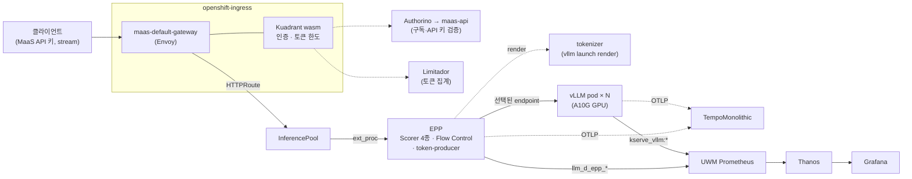
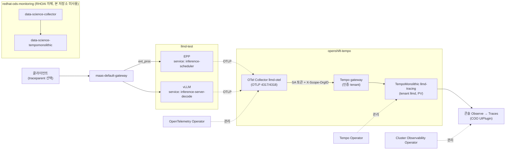

# openshift-ai-llmd-demo

OpenShift AI 3.5(RHOAI 3.5.1)에서 GA된 **llm-d 분산 추론 기능**을 **MaaS(Models-as-a-Service) 게이트웨이와
결합한 상태로** 시연·검증하는 시나리오 모음과 재현 하네스이다. 모든 시나리오는 실클러스터에서 측정하였으며,
측정 절차는 `harness/harness.sh` 명령으로 재현된다.

## 목적

1. **llm-d GA 기능의 실효 검증.** 우선순위 Flow Control, KV 캐시 인지 라우팅, 추론 인지 라이프사이클,
   멀티모달 라우팅, 분산 트레이싱, TLS 비활성화, Scorer 튜닝, 외부 토크나이저, Controlled Deployment의
   9개 기능이 실제 부하에서 어떤 효과를 내는지 정량화한다(시나리오 21~29).
2. **MaaS + llm-d 통합 경로의 검증.** 클라이언트 요청이 MaaS 인증·토큰 한도를 거쳐 EPP 스케줄링과 vLLM
   추론까지 이어지는 전체 경로에서 동작과 제약을 확인한다.
3. **재현성.** 각 측정은 하네스 명령 하나로 반복 가능하며, 종료 시 클러스터 설정을 원복한다.

## 아키텍처 (실측)

RHOAI 3.5.1에서 llm-d는 별도 설치 없이 KServe `LLMInferenceService`로 제공된다. 컨트롤러는
`redhat-ods-applications`의 preset(`LLMInferenceServiceConfig v3-5-1-kserve-config-llm-*`)을 병합하여
다음 리소스를 생성한다.

| `LLMInferenceService` 설정 | 생성 리소스 | 역할 |
|---|---|---|
| (기본) | `Deployment <name>-kserve`, `Service <name>-kserve-workload-svc` | vLLM 엔진 |
| `spec.router.gateway` / `route` | `HTTPRoute <name>-kserve-route` | Gateway 경로·모델 기반 라우팅 |
| `spec.router.scheduler` | `Deployment <name>-kserve-router-scheduler`(EPP), `InferencePool` | 요청별 endpoint 선택 |
| `spec.router.scheduler.config.inline` | EPP `--config-text` | Scorer, Flow Control, token-producer |
| `baseRefs: [llm-tokenizer preset]` | `Deployment <name>-tokenizer` | `vllm launch render` 외부 토크나이저 |
| `spec.tracing` | vLLM·EPP의 `OTEL_*` 환경변수 | OTLP 트레이스 |
| `spec.router.route.group` / `weight` | 모델 기반 라우팅 규칙의 backend weight | Controlled Deployment |

MaaS(RHOAI 3.5)는 DSC `spec.components.aigateway.modelsAsAService`로 활성화되며, `AITenant`, `maas-api`,
Kuadrant(Authorino·Limitador)로 구성된다. 모델은 `MaaSModelRef`, 접근·한도는 `MaaSSubscription`과
`MaaSAuthPolicy`로 관리한다.



**실측으로 확인한 제약** (상세: [lessonlearn.md](lessonlearn.md))

- **Gateway당 EPP 활성 모델 1개.** EPP 모델이 둘 이상이면 Envoy가 모든 InferencePool route의 ext_proc을
  마지막 EPP로 배정한다(503 또는 스케줄링 누락).
- **MaaS non-streaming 응답의 30~40%가 빈 본문**(HTTP 200, 0바이트)으로 반환된다(Kuadrant wasm-shim).
  클라이언트는 `stream: true`를 사용한다. 토큰 한도는 두 방식 모두 적용된다.
- **MaaS 인증 호출 타임아웃은 200ms**(`failureMode: deny`)이며 control plane 부하 시 0.1~0.4%의 500이 발생한다.
- **EPP 인라인 설정은 전체 교체한다.** merge 패치는 이전 키를 남겨 CrashLoop를 유발하고, 설정 제거는
  기본값으로 복귀시키지 않는다.
- **롤링 재기동에는 여유 GPU 1장이 필요하다**(maxSurge 1, maxUnavailable 0).
- **Authorino listener TLS는 켜야 한다.** odh-model-controller의 `<gateway>-authn-ssl` EnvoyFilter가 TLS로
  접속하므로, TLS off이면 인증이 필요한 모든 MaaS 요청이 500을 반환한다(`maas.sh`에 반영).

## 시나리오

- **11~14 (데이터 병렬화, 장애 복구, 요청 추적, 지연 진단)**: RHOAI 3.5.1, `llmd-test`(Qwen2.5-1.5B-Instruct), g5.24xlarge(A10G), MaaS Gateway 경유.
- **15~16 (병렬화)**: 설계만 완료. A10G × 4가 PCIe로만 연결되어(NVLink 없음) 측정을 보류하였다.
- **21~29 (llm-d GA 기능)**: RHOAI 3.5.1, Qwen2.5-1.5B-Instruct(24번은 Qwen2.5-VL-3B-Instruct), g4dn.xlarge(T4) × 2,
  MaaS Gateway 경유로 측정. 개요와 공통 전제: [llmd-ga-overview.md](docs/scenarios/llmd-ga-overview.md).

| # | 기능 | 검증 내용 | 실측 결과 | 하네스 명령 |
|---|---|---|---|---|
| 11 | [데이터 병렬화와 캐시 인지 라우팅](docs/scenarios/11-data-parallelism.md) | replica 1 vs 2, 분배 방식(`Service`/EPP/session affinity)별 처리량·캐시 적중률 | replica 2에서 EPP 분배는 처리량 ×1.99·적중률 66.7%(이론 상한), `Service` 분배는 ×1.55·41.2%. session affinity는 평상시 이득 없으나 EPP 재시작 시 적중률 94.2% 유지(기본 72.3%) | `scenario11-llmd-dp-affinity` |
| 12 | [장애 및 복구](docs/scenarios/12-failure-recovery.md) | vLLM pod(replica 1·2)와 EPP pod 삭제 시 실패 요청·복구 시간 | replica 1은 약 2분 전면 중단(503), replica 2는 vLLM·EPP 장애 모두 무중단(EPP는 `FailOpen`) | `scenario12-llmd-failure` |
| 13 | [요청 추적](docs/scenarios/13-request-tracing.md) | 캐시 miss(1턴)와 hit(2턴)의 EPP·vLLM span | 적중 시 prefill 0.173→0.032초(−82%), EPP pod 선택 1ms 미만 | `scenario13-llmd-tracing` |
| 14 | [지연 진단](docs/scenarios/14-latency-diagnosis.md) | queue·prefill·decode 병목을 유도한 부하 3종의 판정 | 3종 모두 의도한 병목 판정(평균 기준, 두 단계). p95는 히스토그램 경계로 부정확 | `scenario14-llmd-latency` |
| 15 | [텐서 병렬화(TP)](docs/scenarios/15-tensor-parallelism.md) | 대형 모델 분할 서빙, TP vs 데이터 병렬화 | 설계 완료, 보류: GPU 간 NVLink 없음(PCIe `PHB`) | 미구현 |
| 16 | [Expert 병렬화(EP)](docs/scenarios/16-expert-parallelism.md) | MoE expert 분산 | 설계 완료, 보류: all-to-all 통신에 NVLink 필요 | 미구현 |
| 21 | [우선순위 Flow Control](docs/scenarios/21-flow-control-priority.md) | 포화 시 `InferenceObjective` 우선순위 적용 | 대화형 TTFT 1.7 s vs 대조군 24.3 s. `concurrency-detector` 필요(`utilization-detector`는 우선순위 역전) | `scenario21-llmd-flow-control` |
| 22 | [EPP Scorer 4종](docs/scenarios/22-epp-scorers.md) | KV 캐시 인지 라우팅 | prefix 적중률 83.2% vs 58.4%, TTFT p50 10배 단축, 처리량 2.1배 | `scenario22-llmd-epp-scorers` |
| 23 | [추론 인지 라이프사이클](docs/scenarios/23-inference-aware-lifecycle.md) | 롤링 업데이트 중 요청 유실 | pod 교체로 인한 유실 0건 | `scenario23-llmd-lifecycle` |
| 24 | [멀티모달 라우팅](docs/scenarios/24-multimodal-routing.md) | 동일 이미지 재요청의 캐시 pod 라우팅 | mm 캐시 적중률 76.1% vs 60.8%, TTFT p50 3.8배 단축 | `scenario24-llmd-vlm-{up,run,down}` |
| 25 | [E2E 분산 트레이싱](docs/scenarios/25-e2e-tracing.md) | `spec.tracing` 단일 trace | EPP 5 span + vLLM span 연결, queue/prefill/decode 분해 | `scenario25-llmd-tracing` |
| 26 | [TLS 비활성화](docs/scenarios/26-tls-disable.md) | DSC 전역 TLS off 효과 | 처리량 +3.5%, E2E p50 −2.4% | `scenario26-llmd-tls` |
| 27 | [Scorer 가중치 튜닝](docs/scenarios/27-scheduler-scorer-weights.md) | 캐시 우선 vs 부하 우선 정책 | hot-spot·포화 시 부하 우선 정책 TTFT 2.5배, 처리량 1.6배 | `scenario27-llmd-scorer-weights` |
| 28 | [외부 토크나이저](docs/scenarios/28-external-tokenizer.md) | 토크나이저 서비스 분리 | 독립 Deployment 동작. 텍스트 모델에서는 이득 없음(+36 ms) | `scenario28-llmd-tokenizer` |
| 29 | [Controlled Deployment](docs/scenarios/29-controlled-deployment.md) | route group 가중치 분할 | 90:10 → 92:8, 0:100 → 0:100. 다중 EPP 풀 제약으로 버전 내 스케줄링 미적용 | `scenario29-llmd-canary-{up,shift,down}` |

관측성 테스트케이스 [TC-01~05](docs/test-cases.md)(메트릭 수집·대시보드·알림)는 `./harness.sh llmd-monitoring`으로 구성한다.

### scenarios-2 (RHDP sandbox1343, 하네스 `HARNESS_PROFILE=sno`)

RHOAI 3.5.2, SNO 제어 평면(g6.8xlarge) + GPU 워커 g6.12xlarge(L4 × 4) 2대. 대상 모델은 RedHatAI Qwen3.8-27B(BF16, INT4,
NVFP4, MXFP4)이다. 관측은 Grafana 대시보드 `llmd-pd-latency`(`./harness.sh grafana-dashboard`)로 한다. 요약과 결론은 [docs/scenarios-2/README.md](docs/scenarios-2/README.md)에 있다.

| # | 기능 | 검증 내용 | 결과 | 매니페스트 |
|---|---|---|---|---|
| 2-00 | [P/D 분리 × 텐서 병렬화 준비 작업](docs/scenarios-2/00-pd-disaggregation-setup.md) | 27B 모델을 TP2/TP4로 나누어 P/D 구성, 정밀도 vs 4비트 양자화 비교 | INT4 P/D(prefill TP2 + decode TP2) 구성. 하이브리드 모델 필수 설정(DS conv layout, NIXL side channel) | `manifests/pd/` |
| 2-01 | [GuideLLM 부하 생성기](docs/scenarios-2/01-guidellm-loadgen.md) | GuideLLM 0.8.1을 OpenShift Job으로 실행, direct·MaaS 경로, 내장 시나리오 | INT4 TP2에서 동시 1→4: 출력 26.0→74.9 tok/s, ITL 35→40ms | `./harness.sh guidellm`, `manifests/guidellm/` |
| 2-02 | [P/D 요청 경로](docs/scenarios-2/02-pd-request-path.md) | 요청 1건이 prefill → KV(NIXL) → decode로 처리되는지 | EPP·prefill·decode가 한 trace로 연결. NIXL 기본 주소(localhost) 때문에 KV 전달 전부 실패 → pod IP 지정 후 성공(전송당 약 103MB, 290MB/s) | `manifests/pd/qwen38-int4-pd.yaml` |
| 2-03 | [부하 하 P/D 동작](docs/scenarios-2/03-pd-under-load.md) | GuideLLM 동시 1~16에서 분리율, KV 전달 실패, decode ITL | 분리 정상(KV 실패 0). 8K 프롬프트에서 TTFT 7 → 27초에도 ITL 35.9ms 유지. 병목은 prefill | `./harness.sh scenario2-03-pd-load` |
| 2-04 | [P/D 결정 임계값](docs/scenarios-2/04-pd-decider-threshold.md) | 짧은 프롬프트의 prefill 생략(decider) | `threshold: 1000`: 짧은 요청 prefill 경유 0건, TTFT 0.52 → 0.10초. 긴 요청은 그대로 분리 | `./harness.sh scenario2-04-pd-decider` |
| 2-05 | [prefix 캐시와 P/D](docs/scenarios-2/05-pd-prefix-cache.md) | 채팅 2번째 질문의 prefill 생략과 decode 캐시 재사용(항상 분리 vs 임계값 분리) | prefix 캐시로 2번째 질문 TTFT −40%. 블록 1,568토큰 때문에 기준 250에선 생략 안 됨, 2,000에서 prefill 0/40·TTFT 추가 −9% | `./harness.sh scenario2-05-pd-prefix-cache` |
| 2-06 | [P/D 역할별 GPU 메모리 설정](docs/scenarios-2/06-gpu-memory-utilization.md) | prefill·decode의 메모리 성격 차이를 이용한 OOM 회피(개요) | 전 구성 OOM 없음. 권장: prefill 0.75 + max-num-seqs 8, decode 0.90. 장문 부하는 Flow Control | - |
| 2-06-1 | [역할별 gpu-memory-utilization](docs/scenarios-2/06-1-role-memory-utilization.md) | prefill 0.75, decode 0.90(한계 0.95) | 0.90: decode KV +14.4%, 0.95: +28.8%. 기동·L1·L2 OOM 없음, 지연 변화 없음 | - |
| 2-06-2 | [prefill --enforce-eager](docs/scenarios-2/06-2-prefill-enforce-eager.md) | prefill CUDA graph 메모리·컴파일 시간 회수 | 기동 145→64초, KV +2.19GiB. L2 처리량 −13~22%로 비권장 | - |
| 2-06-3 | [prefill max-num-batched-tokens](docs/scenarios-2/06-3-prefill-batched-tokens.md) | 활성화 피크 축소 | 2048은 L4 기본값과 같아 효과 없음 | - |
| 2-06-4 | [prefill max-num-seqs](docs/scenarios-2/06-4-prefill-max-num-seqs.md) | prefill 동시 요청 축소 | graph −0.68GiB, KV +7.2%, 처리량 동일. 권장 | - |
| 2-06-5 | [역할별 메모리 설정 통합](docs/scenarios-2/06-5-role-memory-combined.md) | 2-06-1~4 통합 구성의 OOM 여유·KV·지연 | decode KV +14.4%, prefill GPU −1.7GiB. eager 때문에 L2 처리량 −13% | - |
| 2-06-6 | [EPP Flow Control로 KV 포화 회피](docs/scenarios-2/06-6-epp-flow-control.md) | decode util을 낮춰 OOM 여유를 두고, KV 축소분은 EPP 입장 제한·우선순위로 보완 | decode KV 최대 99%→75%, preemption 83→0, 장문 처리량 +76%, 대화형 TTFT p50 8.8초(대조군 296초) | - |
| 2-07 | [장문 호출과 MaaS 토큰 한도](docs/scenarios-2/429-error/07-maas-token-ratelimit.md) | 토큰/15초 한도에서 장문 요청 후 429 발생 구조(응답 후 차감, 동시 초과, 스트리밍 usage, 2단 한도) | 응답 후 차감 + 첫 차감부터의 고정 구간. 동시 장문이 한도 2.4배 사용, 단문 7.2초 연쇄 차단. 1분 구간 차단 25초. Retry-After 없음 | `./harness.sh scenario2-07-maas-ratelimit` |
| 2-08 | [429 원인 검증과 완화 방안](docs/scenarios-2/429-error/08-429-root-cause-and-mitigation.md) | 원인 가설 H1~H3 판정, 방안 M1~M6·S1~S2를 하위 시나리오로 매핑 | 429는 MaaS 토큰 한도(고정 구간, 응답 후 입출력 합산 차감)에서만 발생. 서버 포화는 429가 아니라 ELB 60초 끊김 | `./harness.sh scenario2-08-mitigation` (`MAAS_MIT_ARMS=single io saturate`) |
| 2-08-0 | [rate-limit 헤더 기반 재시도](docs/scenarios-2/429-error/08-0-ratelimit-headers.md) | Limitador `X-RateLimit-Reset`으로 Retry-After 대체 | 헤더 미전달: Limitador v2.4.2의 `CheckRateLimit`(토큰 한도 경로)이 헤더를 만들지 않음. v2.6.0부터 지원 | `MAAS_MIT_ARMS=headers` |
| 2-08-1 | [토큰 한도 재설계](docs/scenarios-2/429-error/08-1-limit-sizing.md) | 구간 한도 크기와 2단 한도 | 20K/15s: 429 26건 → 25K/15s(장문 × 동시 2): 0건, 작업 지연 p50 8.5 → 2.1초. 2단 한도: 장기 소진 후 48초 차단 | `MAAS_MIT_ARMS=limit` |
| 2-08-2 | [prefix 캐시와 토큰 차감](docs/scenarios-2/429-error/08-2-prefix-cache.md) | prefill prefix 캐시 꺼짐/켜짐의 차감량·TTFT | 재질의 TTFT −65%, 차감 토큰 동일(429 대책 아님) | `MAAS_MIT_ARMS=prefix` |
| 2-08-3 | [prefill max_num_batched_tokens](docs/scenarios-2/429-error/08-3-batched-tokens.md) | 장문 prefill 중 단문 TTFT | 429와 무관, 2048에서 단문 TTFT −13% | `MAAS_MIT_ARMS=chunk` |
| 2-08-4 | [429 재시도 정책](docs/scenarios-2/429-error/08-4-retry-backoff.md) | 즉시·고정 15초·지수 백오프 | 백오프: 429 6건(즉시 36건), 완료 시간 +3%(고정 15초 +29%) | `MAAS_MIT_ARMS=retry` |
| 2-08-5 | [세션당 동시 실행 제한](docs/scenarios-2/429-error/08-5-concurrency-cap.md) | 동시 4/2/1의 초과량과 단문 429 | 동시 1: 429 0건, 단문 TTFT 24.5 → 5.7초, 완료 시간 +40% | `MAAS_MIT_ARMS=conc` |
| 2-08-6 | [구독 분리](docs/scenarios-2/429-error/08-6-subscription-split.md) | 장문·대화형을 다른 구독으로 | 단문 429 6 → 0, 지연은 GPU 공유로 남음 | `MAAS_MIT_ARMS=split` |
| 2-08-7 | [입력 압축 효과 산정](docs/scenarios-2/429-error/08-7-input-compression.md) | RAG 요약·reranker의 차감 효과 계산 | 입력 12K → 4K 압축 시 구간당 통과 2 → 5건 | - |

## 사전 조건

- OpenShift 4.22, RHOAI 3.5.1(`DataScienceCluster` Ready, KServe Managed), NVIDIA GPU Operator
- GPU 노드: 현재 구성은 g5.24xlarge(A10G 24GB × 4). 21~28은 `llmd-test` replica 2, 29는 v1/v2로 GPU 2장을
  사용하며, 롤링 재기동 시나리오(23·25·26)는 여유 GPU 1장을 추가로 요구한다
- `oc login`(cluster-admin). bastion은 선택 사항이다(`HARNESS_EXEC=auto`는 로컬 `oc` 세션을 사용)
- 클러스터 접속 정보는 `AGENT.md`(gitignore)에 둔다: `cp AGENT.md.example AGENT.md`

```sh
oc get datasciencecluster default-dsc -o jsonpath='{.status.conditions[?(@.type=="Ready")].status}'
oc get crd llminferenceservices.serving.kserve.io inferenceobjectives.llm-d.ai
oc get nodes -l nvidia.com/gpu.present=true
```

## 재현 방법 (에이전트/사람 공용 실행 절차)

아래 명령은 `harness/` 디렉터리에서 실행한다.

하네스는 클러스터 프로파일(`HARNESS_PROFILE`)에 따라 설정을 나눈다. `aws`(기본)는 openshift-aws-harness로 구축한
다중 노드 클러스터용이다. `sno`는 [scenarios-2](docs/scenarios-2/)를 수행하는 RHDP 클러스터(sandbox1343, SNO 제어 평면 +
GPU 워커)용이며, 로컬 `oc login` 세션으로 실행하고 데모 모델을 replicas 1로 배포한다. GPU 2장 이상이 필요한
시나리오(11, 12, 22, 23, 24, 26, 27, 29)는 GPU가 부족하면 실행을 거부한다.

```sh
./harness.sh status                                # 다중 노드 클러스터(aws, 기본)
HARNESS_PROFILE=sno ./harness.sh sno-check         # scenarios-2: 노드·GPU·RHOAI·DSC·오퍼레이터 점검
```

1. **선행 조건 준비** — UWM, Grafana, CRD·Gateway 점검, 여유 GPU 보고
   ```sh
   ./harness.sh llmd-prereq
   ```
2. **MaaS 활성화** — RHOAI 버전을 판별하여 3.5+ 경로(`aigateway.modelsAsAService`)를 적용
   ```sh
   ./harness.sh maas
   oc get aitenant -A; oc get gateway -n openshift-ingress
   ```
3. **데모 모델 배포와 MaaS 등록** — EPP 기본 활성
   ```sh
   ./harness.sh llmd-test-up                 # manifests/llmd-test-llminferenceservice.json
   LLMD_NAMESPACE=llmd-test LLMD_NAME=llmd-test MAAS_USERS=<user>,system:serviceaccount:llmd-bench:loadgen \
     ./harness.sh maas-register-model          # 토큰 한도 기본 10억/시간(부하 시험용)
   ./harness.sh maas-api-key                  # sk-oai-* 키 → Secret llmd-bench/loadgen-token
   oc get llminferenceservice,inferencepool -n llmd-test
   ```
4. **관측 구성** — PrometheusRule, Grafana 대시보드, 트레이싱
   ```sh
   GRAFANA_ADMIN_PASSWORD=<pw> ./harness.sh llmd-prereq      # 선택: Grafana admin 암호 고정
   LLMD_NAMESPACE=llmd-test ./harness.sh llmd-monitoring
   ./harness.sh tracing && ./harness.sh llmd-tracing         # Tempo·Collector·콘솔 Traces, llmd-test 추적 켜기
   ./harness.sh status
   ```
5. **시나리오 실행** — 11~14, 21~28은 `llmd-test`로 실행하고, 24·29는 모델을 교체하여 마지막에 실행한다.
   ```sh
   ./harness.sh scenario11-llmd-dp-affinity                     # S11_ARMS="A B C D E" 또는 "F0 F1 F2"
   ./harness.sh scenario12-llmd-failure
   ./harness.sh scenario13-llmd-tracing
   ./harness.sh scenario14-llmd-latency
   ./harness.sh scenario22-llmd-epp-scorers                     # 예시. S22_* 로 규모 조정
   ./harness.sh llmd-test-down && ./harness.sh scenario29-llmd-canary-up
   ./harness.sh scenario29-llmd-canary-shift
   ./harness.sh scenario29-llmd-canary-down && ./harness.sh llmd-test-up
   ```
6. **MaaS 경로 점검**
   ```sh
   MAAS_CHECK=nonstream ./harness.sh maas-checks                # 빈 본문 발생률
   MAAS_CHECK=token-limit ./harness.sh maas-checks              # 토큰 한도 적용(원복 포함)
   ```

임의 부하와 지표 조회는 `./harness.sh llmd-loadgen`(스트리밍 TTFT/E2E, 클라이언트 측 코드 집계)과
`QUERY='<promql>' ./harness.sh llmd-promql`을 사용한다.

## 트레이싱

`LLMInferenceService.spec.tracing`을 지정하면 컨트롤러가 vLLM과 EPP에 `OTEL_*` 환경변수를 주입한다. 두 컴포넌트는
span을 OTel Collector로 보내고, Collector가 ServiceAccount 토큰과 tenant 헤더를 붙여 멀티테넌시 Tempo에 저장한다.
콘솔 Observe → Traces는 멀티테넌시 Tempo만 표시하므로 이 구성이 필요하다.



- 권한: Collector의 SA에 tenant `llmd`의 traces `create`, 조회자에게 `get`을 부여한다(`llmd-tracing-traces-write/read`).
- Gateway(Envoy)와 MaaS 인증(Authorino) 구간은 trace에 포함되지 않는다.

켜기·끄기(`harness/` 디렉터리). 켜고 끌 때 vLLM pod가 순차 재기동되므로 여유 GPU 1장이 필요하다.

```sh
./harness.sh tracing                                   # Tempo, Collector, 콘솔 Traces UI 설치(1회)
./harness.sh llmd-tracing                              # llmd-test 추적 켜기 + 요청 3건으로 수신 확인
TRACING=off ./harness.sh llmd-tracing                  # 끄기
LLMD_NAMESPACE=<ns> LLMD_NAME=<name> LLMD_TRACING_SAMPLER=0.1 ./harness.sh llmd-tracing   # 다른 모델, 샘플링 10%
oc get llminferenceservice llmd-test -n llmd-test -o jsonpath='{.spec.tracing}'
```

## UI로 보기

URL은 클러스터마다 다르며 `AGENT.md`에 기록한다.

- **Grafana** — `llm-d Observability` 대시보드(namespace 선택). `llmd-monitoring` 실행 후 표시된다.
  ```sh
  oc get route -n gpu-monitoring
  oc get secret gpu-grafana-admin-credentials -n gpu-monitoring -o jsonpath='{.data.GF_SECURITY_ADMIN_PASSWORD}' | base64 -d
  ```
- **Traces(Tempo)** — OpenShift 콘솔 Observe → Traces에서 `openshift-tempo/llmd-tracing`(tenant `llmd`)을 선택한다.
  ```sh
  oc get uiplugin distributed-tracing
  ```
- **MaaS 모델 목록** — API 키로 등록 모델을 확인한다.
  ```sh
  curl -sk https://maas.<apps-domain>/v1/models -H "Authorization: Bearer <sk-oai-...>"
  ```

## 디렉터리 구조

```
harness/
  harness.sh                  진입점 (./harness.sh 로 명령 목록 확인)
  config.env                  프로파일 선택(HARNESS_PROFILE), 모델 기본값
  lib.sh                      실행 위치 판별, ssh_bastion/scp_to_bastion (local 모드는 로컬 실행)
  tools/loadgen.py            클러스터 내 부하 생성기 (스트리밍 TTFT/E2E, multi-prefix·multi-turn·image, ignore_eos, 턴 사이 정지)
  remote/lib/bench.sh         공통 함수 (부하 Job, Thanos, pod 카운터, EPP 설정, replica, 추적, Tempo 조회, 사전 점검)
  remote/scenario1[1-4]-*.sh  시나리오 11~14 (llmd-test 기준)
  remote/scenario2*.sh        시나리오 21~29
  remote/maas*.sh             MaaS 설치(RHOAI 3.5+), 모델 등록·해제, API 키, 점검
  remote/tracing.sh           Tempo(멀티테넌시), OTel Collector, 콘솔 Traces UI
  remote/llmd-*.sh            사전 점검, 모델 배포, 부하, PromQL, 모니터링
  remote/dashboards/          llmd-observability.json (지연 분해), llmd-pd-latency.json (P/D 구간별 지연)
  remote/grafana-dashboard.sh dashboards/*.json 을 GrafanaDashboard 로 반영 (grafana-dashboard 명령)
  remote/sno/sno-check.sh     scenarios-2 클러스터 점검 (sno-check 명령)
  remote/guidellm.sh          GuideLLM 벤치마크 Job (guidellm 명령, 결과는 harness/results/guidellm/)
  profiles/                   클러스터 프로파일: aws(기본), sno(scenarios-2)
docs/
  scenarios/                  11~14(llmd-test), 15~16(설계, 보류), 21~29(llm-d GA, llmd-ga-overview.md)
  scenarios/images/           시나리오별 화면 캡처
  scenarios-2/                sandbox1343 시나리오 (2-00 P/D 분리 × TP)
    429-error/                2-07·2-08 MaaS 토큰 한도 429 원인과 완화 방안
  test-cases.md               관측성 테스트케이스 TC-01~05
  test-results-2026-09-07.md  RHOAI 3.4.4 실측 결과
manifests/
  llmd-test-llminferenceservice.json   데모 모델 스펙 (llmd-test-up 에서 사용, aws 프로파일)
  sno/                                 데모 모델 스펙 replicas 1 (sno 프로파일)
  pd/                                  scenarios-2 매니페스트 (Qwen3.8-27B INT4 TP2)
  prometheusrule-llmd-alerts.yaml      TTFT·에러율 알림 규칙
  servicemonitor-llmd.yaml             자동 생성 모니터 사본(참고)
  dsci-observability-patch.yaml        관측성 스택 패치 예시
lessonlearn.md                발견 이슈와 교훈 (플랫폼 제약 포함)
AGENT.md.example              AGENT.md 템플릿 (AGENT.md는 gitignore)
```
