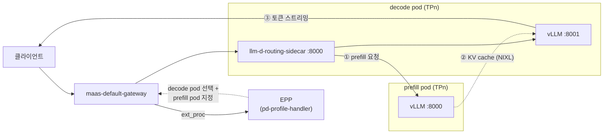

# 시나리오 2-00: Prefill/Decode 분리 × 텐서 병렬화 준비 작업

**모듈:** 분산 환경 활용 > 추론 단계 분리
**환경:** RHDP sandbox1343(SNO 제어 평면), OpenShift 4.20.42, RHOAI 3.5.2(vLLM 0.24.0+rhaiv.15).
GPU 워커 g6.12xlarge(L4 24GB × 4) 2대. 하네스 프로파일 `HARNESS_PROFILE=sno`
**모델:** RedHatAI Qwen3.8-27B — BF16, INT4, NVFP4, MXFP4
**상태:** INT4 TP2 단일 인스턴스 검증 완료. P/D 1단계 기동 완료(2026-11-05). 측정은 시나리오 2-02~2-05.

## 목적

LLM 추론은 prefill 단계(프롬프트 일괄 계산, 연산 집약)와 decode 단계(토큰 순차 생성, 메모리 대역폭 집약)로 나뉜다.
P/D 분리는 두 단계를 서로 다른 pod에 배치하고, prefill pod가 계산한 KV cache를 NIXL로 decode pod에 전달한다.
본 시나리오는 GPU 1장에 적재되지 않는 27B 모델을 텐서 병렬화(TP)로 나누어 올리고, 그 위에서 P/D 분리의 동작을
검증한다. 또한 BF16과 4비트 양자화 모델의 GPU 배치, KV 용량, 지연을 비교한다.

## 요청 경로



1. EPP는 decode pod를 선택한다. 캐시되지 않은 프롬프트 토큰 수가 임계값을 넘으면 prefill pod도 지정한다.
2. decode pod의 routing sidecar는 prefill pod에 KV cache 계산을 요청한다.
3. decode pod의 vLLM은 prefill pod의 KV cache를 NIXL로 가져와 토큰을 생성한다. TP 구성에서는 prefill rank *i*가
   decode rank *i*에 자기 몫의 KV를 전달한다.

## 노드·GPU·모델 배치

| 노드 | 타입 / AZ | GPU | 역할 |
|---|---|---|---|
| master | g6.8xlarge / us-east-1a | L4 × 1 | control-plane, EPP, Gateway, MaaS, Grafana. GPU는 사용하지 않음 |
| gpu-a | g6.12xlarge / us-east-1c | L4 × 4 | 모델 서빙 |
| gpu-b | g6.12xlarge / us-east-1c | L4 × 4 | 모델 서빙 |

**1단계: 4비트 모델, prefill TP2 + decode TP2 (노드 내 KV 전달)**

```
 gpu-a (L4 × 4)                                   gpu-b (L4 × 4)
┌───────────────────────┬───────────────────────┐ ┌───────────────────────┬───────────────────────┐
│ GPU0   GPU1           │ GPU2   GPU3           │ │ GPU0   GPU1           │ GPU2   GPU3           │
│ prefill TP2           │ decode TP2            │ │ prefill TP2           │ decode TP2            │
│ 모델 X (예: INT4)     │ 모델 X                │ │ 모델 Y (예: MXFP4)    │ 모델 Y                │
└──────────┬────────────┴──────────▲────────────┘ └──────────┬────────────┴──────────▲────────────┘
           └──── KV (NIXL) ────────┘                         └──── KV (NIXL) ────────┘
```

**2단계: BF16, prefill TP4 + decode TP4 (노드 간 KV 전달)**

```
 gpu-a (L4 × 4)                                   gpu-b (L4 × 4)
┌───────────────────────────────────────────────┐ ┌───────────────────────────────────────────────┐
│ GPU0   GPU1   GPU2   GPU3                     │ │ GPU0   GPU1   GPU2   GPU3                     │
│ prefill TP4 — Qwen3.8-27B (BF16)              │ │ decode TP4 — Qwen3.8-27B (BF16)               │
└──────────────────────┬────────────────────────┘ └──────────────────────▲────────────────────────┘
                       └──────────── KV (NIXL, 같은 AZ) ──────────────────┘
```

| 모델 | 가중치 | TP | GPU당 가중치 | GPU당 KV cache | P/D GPU | 단계 |
|---|---|---|---|---|---|---|
| BF16 | 55.6GB | 4 | 약 13.9GB | 약 4GB (추정) | 4 + 4 | 2 |
| INT4 (W4A16) | 19.5GB | 2 | **8.51 GiB (실측)** | **7.64 GiB (실측)** | 2 + 2 | 1 |
| NVFP4 (FP4·FP8 혼합) | 24.7GB | 2 | 약 12.3GB | 약 5GB (추정) | 2 + 2 | 1 |
| MXFP4 (W4A4) | 19.8GB | 2 | 약 9.9GB | 약 7GB (추정) | 2 + 2 | 1 |

- 4비트 모델도 L4 1장에 적재하면 KV cache 공간이 남지 않으므로 TP2를 적용한다.
- 모델은 full attention 16층과 linear attention 48층으로 구성되고, KV head는 4개이다. TP4까지 KV head가 균등 분할된다.
- 양자화 모델의 KV cache는 FP8이다. INT4 TP2의 KV 용량은 373,321 토큰(16,384토큰 요청 기준 동시 22.8개)이다.
- `spec.template.nodeSelector`(decode)와 `spec.prefill.template.nodeSelector`(prefill)에 `kubernetes.io/hostname`을
  지정하여 배치를 고정한다.

```sh
oc get nodes -l node-role.kubernetes.io/gpu -L topology.kubernetes.io/zone,nvidia.com/gpu.count
oc get pods -n llmd-pd -o wide -L llm-d.ai/role
```

## RHOAI 3.5.2 구성 요소

| 구성 요소 | 내용 |
|---|---|
| prefill 템플릿 | `v3-5-2-kserve-config-llm-prefill-template`. vLLM 포트 8000 |
| decode 템플릿 | `v3-5-2-kserve-config-llm-decode-template`. vLLM 포트 8001, initContainer `llm-d-routing-sidecar`(포트 8000, `--kv-connector=nixlv2`) |
| TP | `spec.parallelism.tensor`, `spec.prefill.parallelism.tensor` → vLLM `--tensor-parallel-size` |
| 커널(INT4) | 가중치 `MarlinLinearKernel`, linear attention Triton/FLA GDN, TP 통신 PYNCCL |
| 인자 전개 | 템플릿은 `VLLM_ADDITIONAL_ARGS`를 `eval`로 전개한다. JSON 값은 작은따옴표로 감싼다 |

```sh
oc get llminferenceserviceconfig -n redhat-ods-applications
oc explain llminferenceservice.spec.prefill
```

## 사전 필요 설정

RHOAI 3.5.2의 P/D 템플릿만으로는 동작하지 않는다. 아래 설정이 없으면 기동 실패하거나, 응답은 200이지만 P/D가 동작하지
않는다(2026-11-05 확인).

| 설정 | 없을 때 증상 | 원인 | 확인 |
|---|---|---|---|
| `VLLM_SSM_CONV_STATE_LAYOUT=DS` (prefill·decode) | prefill 기동 실패: `Mamba conv transfer requires DS conv state layout` | 하이브리드 모델(linear attention 층)의 conv 상태 전달은 DS 형식만 지원 | `oc logs <prefill-pod> -c main \| grep -i 'conv state'` |
| `VLLM_NIXL_SIDE_CHANNEL_HOST` = `status.podIP` (prefill·decode) | 응답 200이나 KV 전달 전부 실패. decode 로그 `Remote NIXL agent engine ID mismatch`, prefill 로그 `Releasing expired KV blocks` | 기본값 `localhost`. prefill이 handshake 주소로 `localhost`를 알려 decode가 자기 NIXL에 접속한다. decode는 프롬프트를 재계산하여 응답 | decode `vllm:nixl_num_failed_transfers_total`, prefill `vllm:nixl_num_kv_expired_reqs_total`이 0, decode `vllm:nixl_xfer_time_seconds_count` 증가 |
| `kv_role`: prefill `kv_producer`, decode `kv_consumer` | 경고 `Using kv_role='kv_both' with NixlConnector is deprecated` | `kv_both`는 향후 제거 예정 | vLLM 기동 로그 |
| `--limit-mm-per-prompt.image=0 --limit-mm-per-prompt.video=0`, `--gpu-memory-utilization=0.85` | L4 기동 시 CUDA OOM | 비전 인코더 메모리 프로파일링 | vLLM 기동 로그 |
| `VLLM_ADDITIONAL_ARGS`의 JSON은 작은따옴표로 감쌈 | `--kv-transfer-config` 파싱 오류 | 템플릿이 값을 `eval`로 전개 | vLLM `non-default args` 로그 |

```yaml
env:
- name: VLLM_SSM_CONV_STATE_LAYOUT
  value: DS
- name: VLLM_NIXL_SIDE_CHANNEL_HOST
  valueFrom: {fieldRef: {fieldPath: status.podIP}}
```

**운영상 유의점**

| 항목 | 내용 |
|---|---|
| EPP 플러그인 이름 | EPP는 `pd-profile-handler`(`threshold: 0`)를 `disagg-profile-handler` + `always-disagg-pd-decider`로, `prefill-header-handler`를 `disagg-headers-handler`로 변환한다(`oc logs <epp> \| grep 'Effective raw configuration'`) |
| Gateway당 EPP 모델 1개 | 같은 `maas-default-gateway`에 EPP 모델이 둘이면 모든 경로가 마지막 EPP로 연결된다. P/D 모델을 올리기 전에 다른 EPP 모델을 내린다(`oc get inferencepool -A`) |
| 설정 변경 | prefill·decode가 한 노드에 고정되어 여유 GPU가 없으므로 롤링 업데이트가 Pending에 머문다. `spec.replicas`와 `spec.prefill.replicas`를 0으로 내렸다가 올린다(하네스는 P/D 모델을 자동으로 이렇게 처리) |
| 준비 판정 | spec 변경 직후의 Ready=True는 이전 세대 값이다. `metadata.generation == status.observedGeneration`과 Ready를 함께 확인한다 |
| P/D 동작 판정 | trace와 응답 코드만으로는 KV 전달 성공 여부를 알 수 없다. NIXL 지표로 확인한다(시나리오 2-02) |
| MaaS 경로 | 모델 등록(`maas-register-model`)과 API 키(`maas-api-key`)가 필요하며, 토큰 한도는 부하 시험에 충분해야 한다 |

## 미확인 사항

| 항목 | 내용 | 확인 방법 |
|---|---|---|
| FP4 커널 | L4(Ada)에는 FP4 하드웨어가 없다. NVFP4·MXFP4의 동작 여부와 커널 | vLLM 기동 로그의 양자화 커널 |
| 하이브리드 P/D | **확인됨.** conv 상태 전달(DS 형식)과 KV 전달 성공. 설정은 사전 필요 설정 참조 | 시나리오 2-02 |
| 노드 내 KV 경로 | 같은 노드의 pod 간 전송이 GPU 직접 전송인지 TCP 우회인지 | prefill·decode 로그의 NIXL/UCX 경로 |
| EPP 설정 | **확인됨.** EPP는 `prefill-header-handler`·`pd-profile-handler`를 `disagg-headers-handler`·`disagg-profile-handler`로 변환하고, `threshold: 0`을 decider `always-disagg-pd-decider`로 적용한다 | `oc logs <epp> \| grep 'Effective raw configuration'` |

## 매니페스트 (1단계, INT4)

`<gpu-a>`는 GPU 워커의 노드 이름이다. 2단계(BF16)는 모델 URI를 `hf://RedHatAI/Qwen3.8-27B`로, `tensor`와 GPU 요청을
4로, prefill과 decode의 노드를 각각 gpu-a와 gpu-b로 바꾼다. `--kv-cache-dtype`은 두 pod에서 같아야 한다.
텍스트 전용 인자(`--limit-mm-per-prompt.*=0`)와 `--gpu-memory-utilization=0.85`는 L4에서 기동 OOM을 막는다.
전체 매니페스트는 [manifests/pd/qwen38-int4-pd.yaml](../../manifests/pd/qwen38-int4-pd.yaml)이다. 설정을 바꿀 때는 같은 노드에
여유 GPU가 없으므로 `spec.replicas`와 `spec.prefill.replicas`를 0으로 내렸다가 올린다(롤링 업데이트는 Pending에 머문다).

```yaml
apiVersion: serving.kserve.io/v1alpha2
kind: LLMInferenceService
metadata:
  name: qwen38-int4-pd
  namespace: llmd-pd
spec:
  model:
    name: Qwen3.8-27B-INT4
    uri: hf://RedHatAI/Qwen3.8-27B-INT4
  replicas: 1                                   # decode
  parallelism: {tensor: 2}
  template:
    nodeSelector: {kubernetes.io/hostname: <gpu-a>}
    tolerations: [{key: nvidia.com/gpu, operator: Exists, effect: NoSchedule}]
    containers:
    - name: main
      env:
      - name: VLLM_SSM_CONV_STATE_LAYOUT      # 하이브리드 모델의 conv 상태를 NIXL로 전달
        value: DS
      - name: VLLM_NIXL_SIDE_CHANNEL_HOST     # 기본값 localhost이면 KV 수신 handshake 실패
        valueFrom: {fieldRef: {fieldPath: status.podIP}}
      - name: VLLM_ADDITIONAL_ARGS
        value: >-
          --max-model-len=16384 --gpu-memory-utilization=0.85 --kv-cache-dtype=fp8 --max-num-seqs=64
          --limit-mm-per-prompt.image=0 --limit-mm-per-prompt.video=0
          --kv-transfer-config='{"kv_connector":"NixlConnector","kv_role":"kv_consumer"}'
      resources:
        limits:   {cpu: "8", memory: 48Gi, nvidia.com/gpu: "2"}
        requests: {cpu: "8", memory: 48Gi, nvidia.com/gpu: "2"}
  prefill:
    replicas: 1
    parallelism: {tensor: 2}
    template:
      nodeSelector: {kubernetes.io/hostname: <gpu-a>}
      tolerations: [{key: nvidia.com/gpu, operator: Exists, effect: NoSchedule}]
      containers:
      - name: main
        env:
        - name: VLLM_SSM_CONV_STATE_LAYOUT
          value: DS
        - name: VLLM_NIXL_SIDE_CHANNEL_HOST
          valueFrom: {fieldRef: {fieldPath: status.podIP}}
        - name: VLLM_ADDITIONAL_ARGS
          value: >-
            --max-model-len=16384 --gpu-memory-utilization=0.85 --kv-cache-dtype=fp8 --max-num-seqs=64
            --limit-mm-per-prompt.image=0 --limit-mm-per-prompt.video=0
            --kv-transfer-config='{"kv_connector":"NixlConnector","kv_role":"kv_producer"}'
        resources:
          limits:   {cpu: "8", memory: 48Gi, nvidia.com/gpu: "2"}
          requests: {cpu: "8", memory: 48Gi, nvidia.com/gpu: "2"}
  router:
    gateway:
      refs:
      - name: maas-default-gateway
        namespace: openshift-ingress
    route: {}
    scheduler:
      config:
        inline:
          apiVersion: llm-d.ai/v1alpha1
          kind: EndpointPickerConfig
          plugins:
          - type: prefill-header-handler
          - type: prefill-filter
          - type: decode-filter
          - type: prefix-cache-scorer
          - type: queue-scorer
          - type: max-score-picker
          - type: pd-profile-handler
            parameters:
              threshold: 0
          schedulingProfiles:
          - name: prefill
            plugins:
            - pluginRef: prefill-filter
            - pluginRef: queue-scorer
            - pluginRef: max-score-picker
          - name: decode
            plugins:
            - pluginRef: decode-filter
            - pluginRef: prefix-cache-scorer
            - pluginRef: queue-scorer
            - pluginRef: max-score-picker
```

```sh
oc create namespace llmd-pd
oc label namespace llmd-pd opendatahub.io/dashboard=true       # RHOAI 대시보드 프로젝트로 표시
oc apply -f qwen38-int4-pd.yaml
oc get llminferenceservice,pods -n llmd-pd
oc logs deploy/qwen38-int4-pd-kserve-router-scheduler -n llmd-pd | grep -i -E 'plugin|error' | head
```

## 관측 구성

### Grafana 대시보드 `llmd-pd-latency`

P/D의 구간별 지연을 한 화면에서 보는 대시보드이다. JSON은
[harness/remote/dashboards/llmd-pd-latency.json](../../harness/remote/dashboards/llmd-pd-latency.json)이며, Grafana
인스턴스 `gpu-monitoring/gpu-grafana`와 Thanos 데이터소스(`llmd-prereq`가 구성)를 전제로 한다.

| 행 | 내용 |
|---|---|
| 0. Overview | E2E·TTFT·ITL p95, 처리량, EPP 오류율, NIXL 실패, P/D 라우팅 결정 분포, 구간별 p95 비교 |
| ① Routing & orchestration | EPP 스케줄링 지연, 플러그인별 지연, pool 포화도, 엔드포인트별 큐 |
| ② Prefill compute | 엔진 연산·큐 대기 시간, sidecar 관측 prefill 지연, prompt TPS, KV·prefix 캐시, GPU 사용률, PCIe 송신 |
| ③ KV cache transfer | NIXL 전송 시간·대역폭·크기, 실패·만료, 노드 네트워크(ENA), TCP 재전송 |
| ④ Decode scheduling & compute | ITL, decode측 TTFT, 대기·실행 요청, KV 사용률, preemption, decode TPS, GPU·PCIe 수신 |
| ⑤ Errors & failures | sidecar 단계별 오류, EPP 오류 코드, 엔드포인트별 NIXL 실패 |

변수는 `datasource`, `namespace`, `prefill_pod`, `decode_pod`, `gpu_node`, `net_dev`이다. 데이터소스를 변수로 받으므로
UID 치환 없이 `GrafanaDashboard`로 적용한다.

```sh
jq -n --rawfile dash harness/remote/dashboards/llmd-pd-latency.json '
  {apiVersion: "grafana.integreatly.org/v1beta1", kind: "GrafanaDashboard",
   metadata: {name: "llmd-pd-latency", namespace: "gpu-monitoring"},
   spec: {instanceSelector: {matchLabels: {dashboards: "gpu-grafana"}}, json: $dash}}' | oc apply -f -
oc get grafanadashboard llmd-pd-latency -n gpu-monitoring       # DashboardSynchronized=True
oc get route gpu-grafana-route -n gpu-monitoring -o jsonpath='{.spec.host}'   # https://<host>/d/llmd-pd-latency
```

하네스는 같은 작업을 수행한다(`HARNESS_PROFILE=sno ./harness.sh grafana-dashboard`). 패널 제목과 설명은 영어이며, 쿼리는 TP 수와 무관하다.

### Tempo 추적

요청 경로(EPP → prefill → decode)를 trace로 확인하기 위해 추적을 구성한다. 구성은 [README 트레이싱](../../README.md#트레이싱)과
같다: vLLM·EPP → OTel Collector `llmd-otel` → 멀티테넌시 TempoMonolithic `llmd-tracing`(tenant `llmd`) → 콘솔
Observe → Traces.

```sh
cd harness
HARNESS_PROFILE=sno ./harness.sh tracing                                                    # Tempo, Collector, 콘솔 UI
HARNESS_PROFILE=sno LLMD_NAMESPACE=llmd-pd LLMD_NAME=qwen38-int4-pd ./harness.sh llmd-tracing   # spec.tracing 적용
oc get llminferenceservice qwen38-int4-pd -n llmd-pd -o jsonpath='{.spec.tracing}'
```

`spec.tracing` 변경은 pod를 다시 만든다. 하네스는 P/D 모델(`spec.prefill` 존재)의 prefill과 decode를 함께 0으로
내렸다가 올린다. trace에서 확인할 사항(prefill span의 서비스 이름, sidecar의 trace 헤더 전달 여부)은 시나리오 2-02에 기록한다.

## 측정 설계

| 측정 | 단계 | 조건 | 확인 사항 |
|---|---|---|---|
| A. 요청 경로 | 1 | 긴 프롬프트(약 2,000토큰) 1건 | prefill pod가 프롬프트를 처리하고 decode pod가 토큰을 생성함 |
| B. 임계값 | 1 | `threshold` 0 / 1000, 짧은(약 100토큰)·긴 프롬프트 | 임계값 미만 요청은 prefill pod를 거치지 않음 |
| C. 양자화 비교 | 1 | INT4 vs MXFP4(또는 NVFP4), 같은 부하 | KV 용량, TTFT, ITL, 초당 생성 토큰 수 |
| D. 정밀도 vs 양자화 | 1·2 | BF16 TP4 P/D(8장) vs 4비트 TP2 P/D × 2(8장) | 같은 GPU 수에서의 지연, 처리량, KV 용량 |
| E. KV 전달 경로 | 1·2 | 노드 내(1단계) vs 노드 간(2단계) | KV 전달 시간과 TTFT 기여 |

지표는 Grafana 대시보드 `llmd-pd-latency`(`gpu-monitoring/gpu-grafana`)로 관측한다. 부하 요청에는
`"chat_template_kwargs": {"enable_thinking": false}`를 지정하여 Qwen3.8의 사고 과정 토큰을 끈다.

```sh
oc exec -n llmd-pd <pod> -c main -- curl -sk https://localhost:<port>/metrics \
  | grep -E '^vllm:(prompt_tokens_total|generation_tokens_total)'       # prefill 8000, decode 8001
oc logs -n llmd-pd <decode-pod> -c llm-d-routing-sidecar | grep -i prefill
```

## 판정 기준

- **A:** 요청 1건에 prefill pod의 `prompt_tokens_total`이 프롬프트 길이만큼, decode pod의 `generation_tokens_total`이
  생성 길이만큼 증가하고, 응답이 HTTP 200이다.
- **B:** `threshold: 1000`에서 짧은 프롬프트는 prefill pod의 카운터를 증가시키지 않는다.

## 예상

- 4비트 모델은 GPU당 가중치가 작아 BF16보다 KV 여유가 크다. 같은 GPU 8장에서 4비트 TP2 P/D 두 세트의 처리량이
  BF16 TP4 P/D 한 세트보다 높을 것이다.
- L4 간 연결은 PCIe이므로 TP4의 all-reduce 비용이 TP2보다 크다. BF16 TP4의 ITL 단축 폭은 작을 것이다.
- 노드 간 KV 전달(2단계)은 노드 내 전달(1단계)보다 TTFT를 늘린다. FP8 KV는 전달량을 BF16의 절반으로 줄인다.

## 원복

```sh
oc delete llminferenceservice --all -n llmd-pd --wait=true && oc delete namespace llmd-pd
oc scale machineset ocp-krjzt-gpu-g6-12xlarge-us-east-1c -n openshift-machine-api --replicas=0
```
