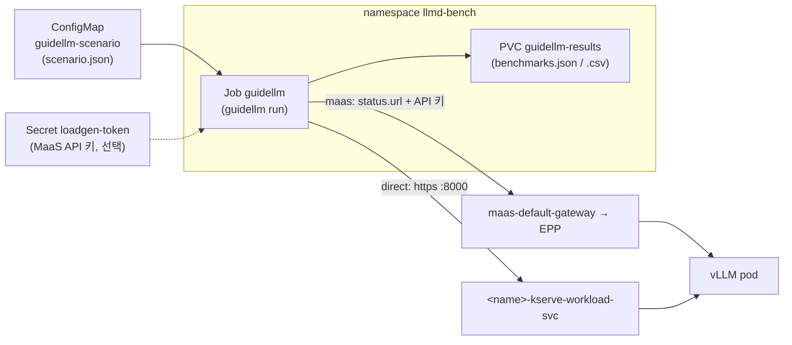

# 시나리오 2-01: GuideLLM 부하 생성기 구축

**모듈:** 분산 환경 활용 > 성능 측정
**환경:** RHDP sandbox1343, OpenShift 4.20.42, RHOAI 3.5.2. GuideLLM 0.8.1(`ghcr.io/vllm-project/guidellm:v0.8.1`)
**상태:** 구축 및 시험 실행 완료

## 목적

GuideLLM은 vLLM 프로젝트의 LLM 벤치마크 도구이다. 동시 요청 수나 요청률을 단계별로 바꾸며 TTFT, 토큰 간 지연(ITL),
처리량을 측정하고 결과를 JSON·CSV로 남긴다. 본 문서는 GuideLLM을 OpenShift의 Job으로 실행하여, 클러스터 내부에서
`LLMInferenceService`에 부하를 주는 방법을 정리한다. 시나리오 2-00(P/D 분리)의 지연·처리량 측정에 사용한다.

## 구성



| 대상 경로 | 주소 | 거치는 구성 요소 | 용도 |
|---|---|---|---|
| direct | `https://<name>-kserve-workload-svc.<ns>.svc:8000` | vLLM | 엔진 자체 성능 |
| maas | `LLMInferenceService.status.url` | MaaS 인증, EPP, vLLM | 실제 서비스 경로, P/D 분배 |

P/D 분리 모델은 EPP가 prefill pod를 지정하므로 maas 경로로 측정한다. direct 경로는 decode pod의 sidecar로 바로
들어가 prefill pod를 거치지 않는다.

## 사전 조건

- 대상 `LLMInferenceService` Ready, 모델 URI가 `hf://<repo>`(GuideLLM이 같은 저장소의 토크나이저를 내려받음)
- 클러스터에서 `ghcr.io`, `huggingface.co` 접근 가능
- maas 경로: MaaS 모델 등록과 API 키 Secret(`llmd-bench/loadgen-token`)

## 구축 절차

```sh
oc create namespace llmd-bench
oc apply -n llmd-bench -f manifests/guidellm/guidellm-job.yaml     # PVC, ConfigMap, Job
oc logs -f job/guidellm -n llmd-bench                              # 진행 및 결과 표
```

[manifests/guidellm/guidellm-job.yaml](../../manifests/guidellm/guidellm-job.yaml)의 ConfigMap에서 대상과 조건을 바꾼다.
Job은 실행 시 Secret의 API 키를 시나리오에 넣으므로 키가 ConfigMap에 남지 않는다. 결과 파일은 PVC에 저장된다.

```sh
oc run guidellm-results -n llmd-bench --image=ghcr.io/vllm-project/guidellm:v0.8.1 --restart=Never \
  --overrides='{"spec":{"containers":[{"name":"guidellm-results","image":"ghcr.io/vllm-project/guidellm:v0.8.1","command":["sleep","300"],"volumeMounts":[{"name":"r","mountPath":"/results"}]}],"volumes":[{"name":"r","persistentVolumeClaim":{"claimName":"guidellm-results"}}]}}'
oc cp llmd-bench/guidellm-results:/results/latest ./guidellm-results
oc delete job guidellm -n llmd-bench                                # 재실행 전 삭제
```

하네스는 대상 모델에서 서빙 이름, 토크나이저, 주소를 읽어 같은 리소스를 만들고 결과를 `harness/results/guidellm/`에
복사한다.

```sh
cd openshift-ai-llmd-demo/harness
HARNESS_PROFILE=sno LLMD_NAMESPACE=llmd-pd LLMD_NAME=qwen38-int4-tp2 \
  GUIDELLM_STREAMS=1,4,8,16 GUIDELLM_PROMPT_TOKENS=1000 GUIDELLM_OUTPUT_TOKENS=256 ./harness.sh guidellm
GUIDELLM_VIA=maas GUIDELLM_SCENARIO=rhaiis/concurrent-1k-1k-equal ./harness.sh guidellm   # 내장 시나리오
```

| 변수 | 기본값 | 의미 |
|---|---|---|
| `GUIDELLM_VIA` | `direct` | `direct` 또는 `maas` |
| `GUIDELLM_PROFILE` | `concurrent` | `concurrent`, `constant`, `poisson`, `sweep`, `synchronous`, `throughput` |
| `GUIDELLM_STREAMS` / `GUIDELLM_RATES` | `1,4,8,16` / `1,2,4` | 단계별 동시 요청 수 / 초당 요청 수 |
| `GUIDELLM_PROMPT_TOKENS` / `GUIDELLM_OUTPUT_TOKENS` | `1000` / `256` | 합성 프롬프트와 응답 길이 |
| `GUIDELLM_MAX_SECONDS` | `60` | 단계별 실행 시간 |
| `GUIDELLM_SCENARIO` | 없음 | 내장 시나리오(아래). 지정하면 데이터·프로파일·단계를 그대로 쓴다 |
| `GUIDELLM_EXTRA_BODY` | `{"chat_template_kwargs":{"enable_thinking":false}}` | 모든 요청 본문에 추가(Qwen3 사고 과정 끔) |

## 시나리오 형식 (GuideLLM 0.8)

| 항목 | 내용 |
|---|---|
| `spec.backend` | `kind: openai_http`, `target`, `model`(서빙 이름), `request_format`, `verify`, `api_key`, `extras.body` |
| `spec.tokenizer` | `kind: huggingface_auto`, `model`(Hugging Face 저장소 ID). 생략하면 서빙 이름을 저장소 ID로 오인하여 실패 |
| `spec.data` | `kind: synthetic_text`, `prompt_tokens`, `output_tokens`(그 밖에 `prefix_tokens`, `turns`, 데이터셋 파일) |
| `spec.profile` | `kind`: 위 프로파일 중 하나 |
| `spec.constraints` | `max_duration`(`seconds`), `max_requests`(`count`) 등. 단계마다 적용 |
| `benchmarks` | 단계 목록. `profile.streams`(concurrent) 또는 `profile.rate`(constant·poisson) |

내장 시나리오(`rhaiis/`): `concurrent-1k-1k-equal`(prefill·decode 균형), `concurrent-2ki-128-equal`(prefill 중심),
`concurrent-512-2ki-norm`(decode 중심), `concurrent-8k-1k-equal`, `concurrent-8k-800-norm`, `concurrent-100k-1k-equal`
(긴 문맥), `concurrent-1k-1k-multiturn`. 각 단계 450초이므로 전체 수십 분이 걸린다.

## 결과 지표

| 지표 | 의미 |
|---|---|
| TTFT / TTFOT | 첫 토큰 / 첫 출력 토큰까지의 시간 |
| ITL | 토큰 간 지연(decode 속도) |
| TPOT | 출력 토큰당 시간(첫 토큰 포함 평균) |
| Request Latency | 요청 전체 시간 |
| Output Tokens Per Sec | 서버 전체 출력 처리량 |

## 시험 실행 (2026-11-05, `llmd-pd/qwen38-int4-tp2`, INT4 TP2, L4 × 2, direct)

프롬프트 512토큰, 응답 128토큰, 단계별 30초.

| 동시 요청 | TTFT p50 | ITL p50 | 요청 지연 p50 | 출력 처리량 |
|---|---|---|---|---|
| 1 | 379ms | 35.3ms | 4.9초 | 26.0 tok/s |
| 4 | 1,490ms | 40.3ms | 6.6초 | 74.9 tok/s |

동시 4에서 처리량은 2.9배가 되었고, ITL은 14% 늘었다. TTFT 증가는 동시 도착한 요청의 prefill 대기이다.

## 주의 사항

- GuideLLM 0.8은 CLI가 바뀌었다. 실행 명령은 `guidellm run`(이전 `guidellm benchmark`)이며 옵션은 `kind=...,키=값` 형식이다.
- 결과 경로는 이미지 기본값 `GUIDELLM__DEFAULT_RESULTS_DIR=/results`를 따른다. 쓰기 가능한 볼륨을 `/results`에 둔다.
- 짧은 프롬프트·저동시성에서 "bottlenecked by the data generation" 경고가 나올 수 있다. 합성 데이터 생성 시간이
  TTFT의 1%를 넘었다는 뜻이며, 결과에 미치는 영향은 작다.
- 이미지는 `v0.8.1`로 고정한다. 태그 `0.8.1`(v 없음)은 존재하지 않는다.
