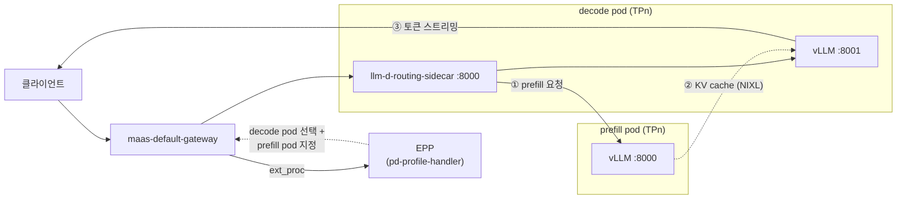

# 시나리오 2-01: Prefill/Decode 분리 × 텐서 병렬화

**모듈:** 분산 환경 활용 > 추론 단계 분리
**환경:** RHDP sandbox1343(SNO 제어 평면), OpenShift 4.20.42, RHOAI 3.5.2(vLLM 0.24.0+rhaiv.15).
GPU 워커 g6.12xlarge(L4 24GB × 4) 2대. 하네스 프로파일 `HARNESS_PROFILE=sno`
**모델:** RedHatAI Qwen3.8-27B — BF16, INT4, NVFP4, MXFP4
**상태:** INT4 TP2 단일 인스턴스 검증 완료. P/D 미실행.

## 목적

LLM 추론은 prefill 단계(프롬프트 일괄 계산, 연산 집약)와 decode 단계(토큰 순차 생성, 메모리 대역폭 집약)로 나뉜다.
P/D 분리는 두 단계를 서로 다른 pod에 배치하고, prefill pod가 계산한 KV cache를 NIXL로 decode pod에 전달한다.
본 시나리오는 GPU 1장에 적재되지 않는 27B 모델을 텐서 병렬화(TP)로 나누어 올리고, 그 위에서 P/D 분리의 동작을
검증한다. 또한 BF16과 4비트 양자화 모델의 GPU 배치, KV 용량, 지연을 비교한다.

## 요청 경로



1. EPP는 decode pod를 선택한다. 캐시되지 않은 프롬프트 토큰 수가 임계값을 넘으면 prefill pod도 지정한다.
2. decode pod의 routing sidecar는 prefill pod에 KV cache 계산을 요청한다.
3. decode pod의 vLLM은 prefill pod의 KV cache를 NIXL로 가져와 토큰을 생성한다. TP 구성에서는 prefill rank *i*가
   decode rank *i*에 자기 몫의 KV를 전달한다.

## 노드·GPU·모델 배치

| 노드 | 타입 / AZ | GPU | 역할 |
|---|---|---|---|
| master | g6.8xlarge / us-east-1a | L4 × 1 | control-plane, EPP, Gateway, MaaS, Grafana. GPU는 사용하지 않음 |
| gpu-a | g6.12xlarge / us-east-1c | L4 × 4 | 모델 서빙 |
| gpu-b | g6.12xlarge / us-east-1c | L4 × 4 | 모델 서빙 |

**1단계: 4비트 모델, prefill TP2 + decode TP2 (노드 내 KV 전달)**

```
 gpu-a (L4 × 4)                                   gpu-b (L4 × 4)
┌───────────────────────┬───────────────────────┐ ┌───────────────────────┬───────────────────────┐
│ GPU0   GPU1           │ GPU2   GPU3           │ │ GPU0   GPU1           │ GPU2   GPU3           │
│ prefill TP2           │ decode TP2            │ │ prefill TP2           │ decode TP2            │
│ 모델 X (예: INT4)     │ 모델 X                │ │ 모델 Y (예: MXFP4)    │ 모델 Y                │
└──────────┬────────────┴──────────▲────────────┘ └──────────┬────────────┴──────────▲────────────┘
           └──── KV (NIXL) ────────┘                         └──── KV (NIXL) ────────┘
```

**2단계: BF16, prefill TP4 + decode TP4 (노드 간 KV 전달)**

```
 gpu-a (L4 × 4)                                   gpu-b (L4 × 4)
┌───────────────────────────────────────────────┐ ┌───────────────────────────────────────────────┐
│ GPU0   GPU1   GPU2   GPU3                     │ │ GPU0   GPU1   GPU2   GPU3                     │
│ prefill TP4 — Qwen3.8-27B (BF16)              │ │ decode TP4 — Qwen3.8-27B (BF16)               │
└──────────────────────┬────────────────────────┘ └──────────────────────▲────────────────────────┘
                       └──────────── KV (NIXL, 같은 AZ) ──────────────────┘
```

| 모델 | 가중치 | TP | GPU당 가중치 | GPU당 KV cache | P/D GPU | 단계 |
|---|---|---|---|---|---|---|
| BF16 | 55.6GB | 4 | 약 13.9GB | 약 4GB (추정) | 4 + 4 | 2 |
| INT4 (W4A16) | 19.5GB | 2 | **8.51 GiB (실측)** | **7.64 GiB (실측)** | 2 + 2 | 1 |
| NVFP4 (FP4·FP8 혼합) | 24.7GB | 2 | 약 12.3GB | 약 5GB (추정) | 2 + 2 | 1 |
| MXFP4 (W4A4) | 19.8GB | 2 | 약 9.9GB | 약 7GB (추정) | 2 + 2 | 1 |

- 4비트 모델도 L4 1장에 적재하면 KV cache 공간이 남지 않으므로 TP2를 적용한다.
- 모델은 full attention 16층과 linear attention 48층으로 구성되고, KV head는 4개이다. TP4까지 KV head가 균등 분할된다.
- 양자화 모델의 KV cache는 FP8이다. INT4 TP2의 KV 용량은 373,321 토큰(16,384토큰 요청 기준 동시 22.8개)이다.
- `spec.template.nodeSelector`(decode)와 `spec.prefill.template.nodeSelector`(prefill)에 `kubernetes.io/hostname`을
  지정하여 배치를 고정한다.

```sh
oc get nodes -l node-role.kubernetes.io/gpu -L topology.kubernetes.io/zone,nvidia.com/gpu.count
oc get pods -n llmd-pd -o wide -L llm-d.ai/role
```

## RHOAI 3.5.2 구성 요소

| 구성 요소 | 내용 |
|---|---|
| prefill 템플릿 | `v3-5-2-kserve-config-llm-prefill-template`. vLLM 포트 8000 |
| decode 템플릿 | `v3-5-2-kserve-config-llm-decode-template`. vLLM 포트 8001, initContainer `llm-d-routing-sidecar`(포트 8000, `--kv-connector=nixlv2`) |
| TP | `spec.parallelism.tensor`, `spec.prefill.parallelism.tensor` → vLLM `--tensor-parallel-size` |
| 커널(INT4) | 가중치 `MarlinLinearKernel`, linear attention Triton/FLA GDN, TP 통신 PYNCCL |
| 인자 전개 | 템플릿은 `VLLM_ADDITIONAL_ARGS`를 `eval`로 전개한다. JSON 값은 작은따옴표로 감싼다 |

```sh
oc get llminferenceserviceconfig -n redhat-ods-applications
oc explain llminferenceservice.spec.prefill
```

## 미확인 사항

| 항목 | 내용 | 확인 방법 |
|---|---|---|
| FP4 커널 | L4(Ada)에는 FP4 하드웨어가 없다. NVFP4·MXFP4의 동작 여부와 커널 | vLLM 기동 로그의 양자화 커널 |
| 하이브리드 P/D | linear attention 층의 상태가 NIXL로 전달되는지 | 1단계 P/D 응답 |
| 노드 내 KV 경로 | 같은 노드의 pod 간 전송이 GPU 직접 전송인지 TCP 우회인지 | prefill·decode 로그의 NIXL/UCX 경로 |
| EPP 설정 | 플러그인 이름과 `pd-profile-handler` 파라미터(EPP 0.10.0) | EPP 로그의 플러그인 로딩 오류 |

## 매니페스트 (1단계, INT4)

`<gpu-a>`는 GPU 워커의 노드 이름이다. 2단계(BF16)는 모델 URI를 `hf://RedHatAI/Qwen3.8-27B`로, `tensor`와 GPU 요청을
4로, prefill과 decode의 노드를 각각 gpu-a와 gpu-b로 바꾼다. `--kv-cache-dtype`은 두 pod에서 같아야 한다.
텍스트 전용 인자(`--limit-mm-per-prompt.*=0`)와 `--gpu-memory-utilization=0.85`는 L4에서 기동 OOM을 막는다.

```yaml
apiVersion: serving.kserve.io/v1alpha2
kind: LLMInferenceService
metadata:
  name: qwen38-int4-pd
  namespace: llmd-pd
spec:
  model:
    name: Qwen3.8-27B-INT4
    uri: hf://RedHatAI/Qwen3.8-27B-INT4
  replicas: 1                                   # decode
  parallelism: {tensor: 2}
  template:
    nodeSelector: {kubernetes.io/hostname: <gpu-a>}
    tolerations: [{key: nvidia.com/gpu, operator: Exists, effect: NoSchedule}]
    containers:
    - name: main
      env:
      - name: VLLM_ADDITIONAL_ARGS
        value: >-
          --max-model-len=16384 --gpu-memory-utilization=0.85 --kv-cache-dtype=fp8 --max-num-seqs=64
          --limit-mm-per-prompt.image=0 --limit-mm-per-prompt.video=0
          --kv-transfer-config='{"kv_connector":"NixlConnector","kv_role":"kv_both"}'
      resources:
        limits:   {cpu: "8", memory: 48Gi, nvidia.com/gpu: "2"}
        requests: {cpu: "8", memory: 48Gi, nvidia.com/gpu: "2"}
  prefill:
    replicas: 1
    parallelism: {tensor: 2}
    template:
      nodeSelector: {kubernetes.io/hostname: <gpu-a>}
      tolerations: [{key: nvidia.com/gpu, operator: Exists, effect: NoSchedule}]
      containers:
      - name: main
        env:
        - name: VLLM_ADDITIONAL_ARGS
          value: >-
            --max-model-len=16384 --gpu-memory-utilization=0.85 --kv-cache-dtype=fp8 --max-num-seqs=64
            --limit-mm-per-prompt.image=0 --limit-mm-per-prompt.video=0
            --kv-transfer-config='{"kv_connector":"NixlConnector","kv_role":"kv_both"}'
        resources:
          limits:   {cpu: "8", memory: 48Gi, nvidia.com/gpu: "2"}
          requests: {cpu: "8", memory: 48Gi, nvidia.com/gpu: "2"}
  router:
    gateway:
      refs:
      - name: maas-default-gateway
        namespace: openshift-ingress
    route: {}
    scheduler:
      config:
        inline:
          apiVersion: llm-d.ai/v1alpha1
          kind: EndpointPickerConfig
          plugins:
          - type: prefill-header-handler
          - type: prefill-filter
          - type: decode-filter
          - type: prefix-cache-scorer
          - type: queue-scorer
          - type: max-score-picker
          - type: pd-profile-handler
            parameters:
              threshold: 0
          schedulingProfiles:
          - name: prefill
            plugins:
            - pluginRef: prefill-filter
            - pluginRef: queue-scorer
            - pluginRef: max-score-picker
          - name: decode
            plugins:
            - pluginRef: decode-filter
            - pluginRef: prefix-cache-scorer
            - pluginRef: queue-scorer
            - pluginRef: max-score-picker
```

```sh
oc create namespace llmd-pd
oc label namespace llmd-pd opendatahub.io/dashboard=true       # RHOAI 대시보드 프로젝트로 표시
oc apply -f qwen38-int4-pd.yaml
oc get llminferenceservice,pods -n llmd-pd
oc logs deploy/qwen38-int4-pd-kserve-router-scheduler -n llmd-pd | grep -i -E 'plugin|error' | head
```

## 측정 설계

| 측정 | 단계 | 조건 | 확인 사항 |
|---|---|---|---|
| A. 요청 경로 | 1 | 긴 프롬프트(약 2,000토큰) 1건 | prefill pod가 프롬프트를 처리하고 decode pod가 토큰을 생성함 |
| B. 임계값 | 1 | `threshold` 0 / 1000, 짧은(약 100토큰)·긴 프롬프트 | 임계값 미만 요청은 prefill pod를 거치지 않음 |
| C. 양자화 비교 | 1 | INT4 vs MXFP4(또는 NVFP4), 같은 부하 | KV 용량, TTFT, ITL, 초당 생성 토큰 수 |
| D. 정밀도 vs 양자화 | 1·2 | BF16 TP4 P/D(8장) vs 4비트 TP2 P/D × 2(8장) | 같은 GPU 수에서의 지연, 처리량, KV 용량 |
| E. KV 전달 경로 | 1·2 | 노드 내(1단계) vs 노드 간(2단계) | KV 전달 시간과 TTFT 기여 |

지표는 Grafana 대시보드 `llmd-pd-latency`(`gpu-monitoring/gpu-grafana`)로 관측한다. 부하 요청에는
`"chat_template_kwargs": {"enable_thinking": false}`를 지정하여 Qwen3.8의 사고 과정 토큰을 끈다.

```sh
oc exec -n llmd-pd <pod> -c main -- curl -sk https://localhost:<port>/metrics \
  | grep -E '^vllm:(prompt_tokens_total|generation_tokens_total)'       # prefill 8000, decode 8001
oc logs -n llmd-pd <decode-pod> -c llm-d-routing-sidecar | grep -i prefill
```

## 판정 기준

- **A:** 요청 1건에 prefill pod의 `prompt_tokens_total`이 프롬프트 길이만큼, decode pod의 `generation_tokens_total`이
  생성 길이만큼 증가하고, 응답이 HTTP 200이다.
- **B:** `threshold: 1000`에서 짧은 프롬프트는 prefill pod의 카운터를 증가시키지 않는다.

## 예상

- 4비트 모델은 GPU당 가중치가 작아 BF16보다 KV 여유가 크다. 같은 GPU 8장에서 4비트 TP2 P/D 두 세트의 처리량이
  BF16 TP4 P/D 한 세트보다 높을 것이다.
- L4 간 연결은 PCIe이므로 TP4의 all-reduce 비용이 TP2보다 크다. BF16 TP4의 ITL 단축 폭은 작을 것이다.
- 노드 간 KV 전달(2단계)은 노드 내 전달(1단계)보다 TTFT를 늘린다. FP8 KV는 전달량을 BF16의 절반으로 줄인다.

## 원복

```sh
oc delete llminferenceservice --all -n llmd-pd --wait=true && oc delete namespace llmd-pd
oc scale machineset ocp-krjzt-gpu-g6-12xlarge-us-east-1c -n openshift-machine-api --replicas=0
```
