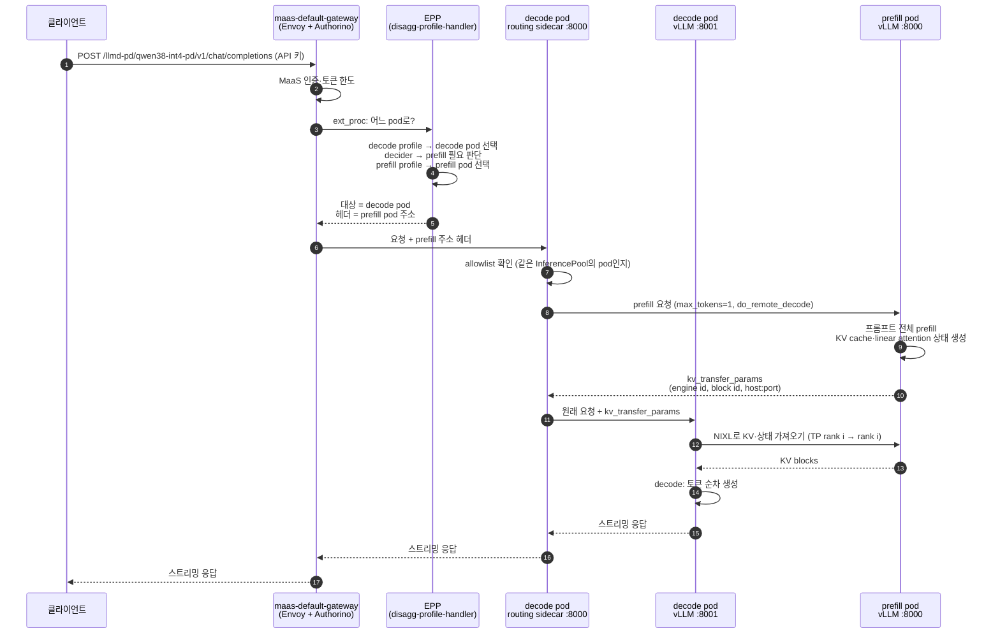
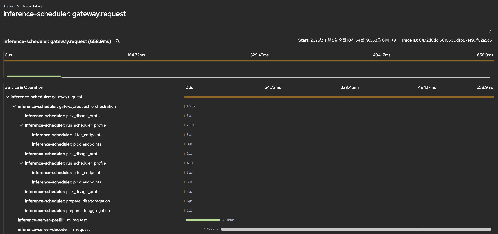

# 시나리오 2-02: P/D 요청 경로 검증

**모듈:** 분산 환경 활용 > 추론 단계 분리
**대상:** `llmd-pd/qwen38-int4-pd`(시나리오 2-00 1단계: INT4, prefill TP2 + decode TP2, 같은 노드)
**상태:** 짧은 요청 3건으로 경로 확인 완료(NIXL side channel 주소 수정 후 KV 전달 성공). 긴 요청과 카운터 검증은 미실행

## 목적

요청 한 건이 설계대로 prefill pod에서 프롬프트를 계산하고, KV cache를 NIXL로 decode pod에 넘긴 뒤, decode pod에서
토큰을 생성하는지 확인한다. 이후 부하 시나리오(2-03~2-05)의 전제이다.

## 요청 처리 흐름



- 1~5: EPP가 decode pod를 고르고, decider가 prefill이 필요하다고 판단하면 prefill pod 주소를 헤더로 붙인다.
- 6~9: sidecar가 주소를 allowlist(같은 InferencePool의 pod)로 확인한 뒤 prefill pod에 프롬프트 계산을 맡긴다.
- 10~12: decode vLLM이 NIXL로 KV와 linear attention 상태를 가져온다(하이브리드 모델이므로
  `VLLM_SSM_CONV_STATE_LAYOUT=DS` 필요). TP2끼리는 같은 순번의 rank가 자기 몫을 주고받는다.
- 헤더가 없으면(prefill 불필요 판단) sidecar는 6단계에서 바로 decode vLLM으로 넘긴다.
- 8·10단계의 요청 필드(`max_tokens=1`, `do_remote_decode`, `kv_transfer_params`)는 llm-d·vLLM P/D 프로토콜 기준이며,
  본 시나리오 실행에서 sidecar·vLLM 로그로 확인한다.

## 확인 지점

| 구성 요소 | pod (라벨 `llm-d.ai/role`) | 확인 방법 | 기대 |
|---|---|---|---|
| EPP | `*-router-scheduler` | 로그의 profile 선택 | `prefill`, `decode` 두 profile 실행 |
| prefill | `*-kserve-prefill-*` (`prefill`) | vLLM `:8000/metrics` | `vllm:prompt_tokens_total` + 프롬프트 길이, `generation_tokens_total` + 1 이하 |
| routing sidecar | decode pod의 `llm-d-routing-sidecar` | 로그 | prefill pod 호출 기록 |
| decode | `*-kserve-*` (`decode`) | vLLM `:8001/metrics` | `generation_tokens_total` + 응답 길이 |
| KV 전달 | prefill·decode의 NIXL 지표·로그 | `vllm:nixl_*` 지표, `NixlConnector` 로그 | 전달 성공, 실패 0 |

## 절차

MaaS 경로(Gateway → EPP)로 보낸다. `stream: true`와 `chat_template_kwargs.enable_thinking=false`를 지정한다.

```sh
NS=llmd-pd; P=$(oc get pod -n $NS -l llm-d.ai/role=prefill -o name); D=$(oc get pod -n $NS -l llm-d.ai/role=decode -o name)
m() { oc exec -n $NS $1 -c main -- curl -sk https://localhost:$2/metrics | grep -E '^vllm:(prompt_tokens_total|generation_tokens_total|request_success_total|nixl)'; }
m $P 8000 > before-p.txt; m $D 8001 > before-d.txt

KEY=$(oc get secret loadgen-token -n llmd-bench -o jsonpath='{.data.token}' | base64 -d)
URL=$(oc get llminferenceservice qwen38-int4-pd -n $NS -o jsonpath='{.status.url}')/v1/chat/completions
curl -sk $URL -H "Authorization: Bearer $KEY" -H 'Content-Type: application/json' -d @request-2k.json   # 약 2,000토큰, max_tokens 64

m $P 8000 > after-p.txt; m $D 8001 > after-d.txt; diff before-p.txt after-p.txt; diff before-d.txt after-d.txt
oc logs -n $NS $D -c llm-d-routing-sidecar --since=2m | grep -i prefill
oc logs -n $NS deploy/qwen38-int4-pd-kserve-router-scheduler --since=2m | grep -i -E 'profile|prefill|decode'
```

짧은 요청(약 100토큰) 한 건도 같은 방법으로 보낸다. 현재 decider(`always-disagg-pd-decider`)는 길이와 무관하게 prefill을 거친다.

## 판정 기준

- 긴 요청: prefill의 `prompt_tokens_total` 증가량이 프롬프트 토큰 수와 같고, decode의 `generation_tokens_total` 증가량이
  응답 토큰 수와 같다. 응답은 HTTP 200이다.
- sidecar 로그에 prefill pod 호출이 있고, NIXL 전달 실패가 없다.
- decode의 `prompt_tokens_total`도 증가할 수 있다. 이는 KV를 받아 적재한 토큰 수이며, 재계산 여부는 NIXL 지표와
  decode의 prefill 시간(`request_prefill_time_seconds`)으로 구분한다.

## 실측 결과 (예비, 2026-11-05 10:54, trace)

시나리오 2-00의 추적 구성 후 `./harness.sh llmd-tracing`이 보낸 짧은 요청(약 20토큰, `max_tokens` 16) 3건을 Tempo에서
조회하였다. 3건 모두 HTTP 200, TTFT p50 0.16초.

**추적 적용 범위.** `spec.tracing`은 prefill과 decode의 vLLM에 모두 적용되고, routing sidecar에는 적용되지 않는다.

| 컨테이너 | trace 서비스 이름 |
|---|---|
| EPP | `inference-scheduler` |
| prefill vLLM | `inference-server-prefill` |
| decode vLLM | `inference-server-decode` |
| decode의 routing sidecar | 없음(span 미생성) |

**trace 구조.** 요청 한 건의 EPP·prefill·decode span이 하나의 trace로 묶였다. sidecar는 span을 만들지 않지만
trace 헤더를 prefill 요청에 전달한다. 대표 trace `c4756b797f33a19613816f0840484960`(786ms):

| 시점 | 서비스 | span | 내용 |
|---|---|---|---|
| +0.0ms | EPP | `gateway.request` 786ms | 요청 전체 |
| +0.3ms | EPP | `pick_disagg_profile`, `run_scheduler_profile` × 2, `prepare_disaggregation` | decode·prefill profile에서 각각 후보 2 → 1 선택. 1ms 미만 |
| +21ms | prefill | `llm_request` 144ms | prefill 0.114초, decode 0초 |
| +168ms | decode | `llm_request` 612ms | prefill 종료 직후 시작. queue 0.016초, prefill 0.038초, decode 0.526초 |



*그림 1. 콘솔 Observe → Traces의 trace `6472d6dc16610500dfb87149df02a5d5`(658.9ms). EPP의 `pick_disagg_profile`·
`run_scheduler_profile` 두 쌍과 `prepare_disaggregation`은 µs 단위이고, prefill `llm_request`(72.18ms, 초록) 직후
decode `llm_request`(575.27ms)가 이어진다.*

- 흐름도의 단계 3~5(EPP 결정), 8~9(prefill 위임), 13(decode 생성)이 trace에서 확인되었다.
- prefill pod는 프롬프트만 계산하고 토큰을 생성하지 않았으며, decode pod는 prefill 종료 후 생성을 시작하였다.
- **KV 전달은 실패하였다(아래 NIXL 확인).** decode의 자체 prefill(0.038초)은 KV를 받지 못해 프롬프트를 다시 계산한
  시간이다. 응답은 HTTP 200이므로 trace와 응답만으로는 실패가 드러나지 않는다.

콘솔에서는 Observe → Traces(`openshift-tempo/llmd-tracing`, tenant `llmd`)에서 다음으로 조회한다.

```
{ trace:id = "c4756b797f33a19613816f0840484960" }
{ resource.service.name = "inference-server-prefill" }
```

## NIXL 확인 방법과 1차 실패 원인

NIXL은 trace에 나타나지 않으므로 vLLM 지표와 로그로 확인한다.

```sh
oc exec -n llmd-pd <prefill-pod> -c main -- curl -sk https://localhost:8000/metrics | grep '^vllm:nixl'
oc exec -n llmd-pd <decode-pod>  -c main -- curl -sk https://localhost:8001/metrics | grep '^vllm:nixl'
oc logs -n llmd-pd <decode-pod> -c main | grep -i 'NIXL transfer failure'
oc logs -n llmd-pd <prefill-pod> -c main | grep -i 'expired KV blocks'
```

| 지표 | 의미 | 1차 결과 (prefill / decode) |
|---|---|---|
| `vllm:nixl_xfer_time_seconds_count` | 성공한 전송 수 | 0 / 0 |
| `vllm:nixl_bytes_transferred_sum` | 전송 바이트 | 0 / 0 |
| `vllm:nixl_num_failed_transfers_total` | decode의 KV 수신 실패 | 0 / **6** (요청 3 × TP rank 2) |
| `vllm:nixl_num_kv_expired_reqs_total` | prefill이 준비했으나 수신되지 않아 만료된 KV | **6** / 0 |
| `vllm:nixl_post_time_seconds`, `vllm:nixl_num_descriptors` | 전송 제출 시간, descriptor 수 | 0 / 0 |

decode 로그는 다음과 같다.

```
NIXL transfer failure: handshake_setup_failed
RuntimeError: Remote NIXL agent engine ID mismatch. Expected 13d9b307-…(prefill), received 051f834e-…(decode 자신)
```

prefill이 KV 위치와 함께 알려 주는 NIXL 접속 주소(side channel)가 기본값 `localhost`여서, decode가 자기 pod의 NIXL
agent에 접속하였다. RHOAI 3.5.2의 P/D 템플릿은 이 값을 지정하지 않는다. 두 pod에 자기 IP를 넣어 해결한다
(`kv_role`도 deprecated인 `kv_both` 대신 prefill `kv_producer`, decode `kv_consumer`로 지정).

```yaml
- name: VLLM_NIXL_SIDE_CHANNEL_HOST
  valueFrom: {fieldRef: {fieldPath: status.podIP}}
```

## 수정 후 결과 (2026-11-05, 짧은 요청 3건)

`VLLM_NIXL_SIDE_CHANNEL_HOST`를 pod IP로 지정한 뒤 같은 시험을 반복하였다.

| 지표 | 1차 (수정 전) | 2차 (수정 후) |
|---|---|---|
| 응답 | 200 × 3 | 200 × 3 |
| decode 전송 성공 (`nixl_xfer_time_seconds_count`) | 0 | **6** (요청 3 × TP rank 2) |
| decode 전송 실패 / prefill 만료 KV | 6 / 6 | **0 / 0** |
| 전송량 합계 | 0 | 616MB (전송 1회당 약 103MB) |
| 전송 시간 / 실효 대역폭 (전송 1회당) | — | 0.353초 / 약 290MB/s |
| 제출 시간 / descriptor 수 (전송 1회당) | — | 2.2ms / 1,616개 |
| TTFT p50 | 0.16초 (KV 미전달, decode 재계산) | 0.52초 (KV 전달 포함) |

- KV 전달이 정상 동작한다. 요청 1건당 TP rank마다 한 번씩 전송한다.
- 약 20토큰 요청에도 전송량이 약 103MB이다. linear attention 층의 상태가 프롬프트 길이와 무관한 고정 크기여서로
  추정한다. 짧은 요청에서는 P/D가 TTFT를 늘린다(시나리오 2-04의 근거).
- 같은 노드 안의 전송인데 실효 대역폭이 약 290MB/s로 낮다. GPU 직접 전송(cuda_ipc)이 아닌 TCP 경유로 추정하며,
  UCX 전송 경로 로그로 확인한다.
- trace와 응답 코드만으로는 KV 전달 성공 여부를 알 수 없다. P/D 검증에는 NIXL 지표가 필수이다.

## 미확인 사항

- 노드 내 KV 전달이 GPU 직접 전송인지 TCP 우회인지(prefill·decode 로그의 UCX 전송 경로). 실효 대역폭 290MB/s는 TCP 경유를 시사한다.
- 짧은 요청의 전송량(약 103MB)이 linear attention 상태 때문인지(긴 요청과 전송량 비교).
