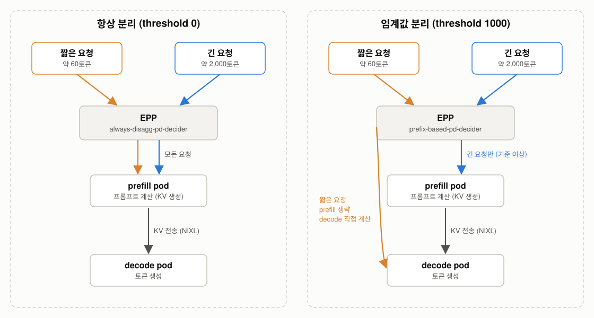
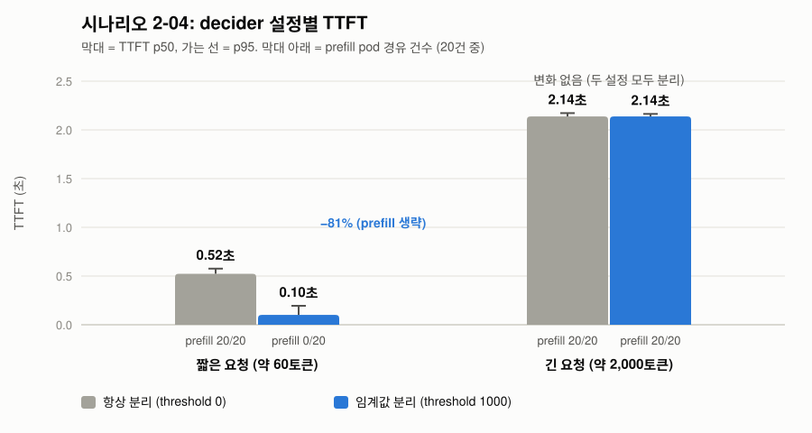

# 시나리오 2-04: P/D 분리 결정 임계값

**모듈:** 분산 환경 활용 > 추론 단계 분리
**대상:** `llmd-pd/qwen38-int4-pd`
**상태:** 실측 완료(2026-11-12)

## 목적

P/D 구성에서 요청은 prefill pod가 프롬프트를 계산해 KV를 만들고, 이를 네트워크(NIXL)로 decode pod에 넘긴다. 긴
프롬프트는 이 분리가 이득이지만, 짧은 프롬프트는 계산보다 "prefill pod 경유 + KV 전송"의 고정 비용이 크다. EPP의 P/D
decider는 프롬프트 길이에 따라 분리 여부를 정할 수 있다. 본 시나리오는 임계값을 두었을 때 짧은 요청은 decode가 직접
계산하고, 긴 요청만 prefill pod를 거치는지 확인한다.



| 구분 | 항상 분리 | 임계값 분리 |
|---|---|---|
| 짧은 요청 | prefill pod 경유 + KV 전송(고정 비용) | decode pod가 프롬프트까지 직접 계산 |
| 긴 요청 | prefill pod 경유 | prefill pod 경유(같음) |
| 기대 | 모든 요청이 같은 경로 | 짧은 요청의 TTFT 감소, decode에 짧은 prefill 부하 추가 |

## EPP 설정

`LLMInferenceService`의 EPP 설정(`spec.router.scheduler.config.inline`)에서 `pd-profile-handler`의 `threshold`를 바꾼다.
RHOAI 3.5.2의 EPP는 이 이전 형식을 새 decider로 변환한다.

| `threshold` | 변환 결과(EPP 로그 `Effective raw configuration`) |
|---|---|
| 0 (현재 운영값) | `always-disagg-pd-decider`: 항상 분리 |
| 1000 | `prefix-based-pd-decider`, `nonCachedTokens: 250`: 캐시되지 않은 프롬프트가 기준 이상일 때만 분리 |

`threshold: 1000`이 `nonCachedTokens: 250`으로 바뀌었다. 변환 규칙은 확인하지 않았으며, 실제 기준값은 로그로 확인한다.
설정은 inline 전체를 교체한다(부분 병합은 EPP CrashLoop을 유발한다).

```sh
oc get llminferenceservice qwen38-int4-pd -n llmd-pd -o jsonpath='{.spec.router.scheduler.config.inline}'
oc patch llminferenceservice qwen38-int4-pd -n llmd-pd --type=json \
  -p '[{"op":"add","path":"/spec/router/scheduler/config","value":{"inline":<threshold를 바꾼 전체 설정>}}]'
oc rollout status deploy/qwen38-int4-pd-kserve-router-scheduler -n llmd-pd
oc logs deploy/qwen38-int4-pd-kserve-router-scheduler -n llmd-pd | grep 'Effective raw configuration' | grep -o 'Name: [a-z-]*decider[^}]*}'
```

## 실험 설계

| 항목 | 값 |
|---|---|
| 조건 | T0: `threshold: 0`, T1: `threshold: 1000` |
| 요청 | 짧은 요청(약 60토큰) 20건, 긴 요청(약 2,000토큰, 매번 다른 문서) 20건, 순차, 응답 16토큰, MaaS 경로 |
| 기록 | prefill pod의 `request_success_total` 증가량(prefill 경유 건수), decode의 NIXL 전송 수, TTFT |

```sh
cd openshift-ai-llmd-demo/harness
HARNESS_PROFILE=sno ./harness.sh scenario2-04-pd-decider     # 종료 시 EPP 설정 원복
```

## 결과 (2026-11-12)

| 조건 | 요청 | prefill 경유 | NIXL 전송(TP 2) | TTFT p50 | TTFT p95 |
|---|---|---|---|---|---|
| T0 (`threshold: 0`) | 짧은 | 20 / 20 | 40 | 0.52초 | 0.58초 |
| T0 | 긴 | 20 / 20 | 40 | 2.14초 | 2.17초 |
| T1 (`threshold: 1000`) | 짧은 | **0 / 20** | **0** | **0.10초** | 0.19초 |
| T1 | 긴 | 20 / 20 | 40 | 2.14초 | 2.16초 |



- T1에서 짧은 요청은 prefill pod를 한 건도 거치지 않았고 KV 전송도 없었다. decode가 프롬프트를 직접 계산하였으며
  TTFT가 0.52초에서 0.10초로 줄었다(−81%). prefill pod 경유와 KV 전송의 고정 비용이 약 0.4초였다.
- 긴 요청은 두 조건 모두 prefill pod를 거쳤고 TTFT도 같았다. 임계값은 긴 요청의 처리에 영향을 주지 않았다.
- 모든 요청이 성공하였고 NIXL 전송 실패는 없었다.

## 결론

decider 임계값을 두면 짧은 요청은 decode가 직접 처리하고 긴 요청만 분리된다. 짧은 요청의 TTFT는 5분의 1로 줄고 긴
요청은 그대로이므로, 대화형 짧은 요청이 섞인 워크로드에서는 `threshold: 0`(항상 분리)보다 임계값을 두는 편이 유리하다.
다만 짧은 요청의 prefill이 decode pod에서 일어나므로, 짧은 요청이 매우 많으면 decode의 토큰 생성(ITL)에 영향을 줄 수
있다. 이 영향은 본 실험(순차 요청)에서는 측정하지 않았다. 실험 후 EPP 설정은 `threshold: 0`으로 원복하였다.
