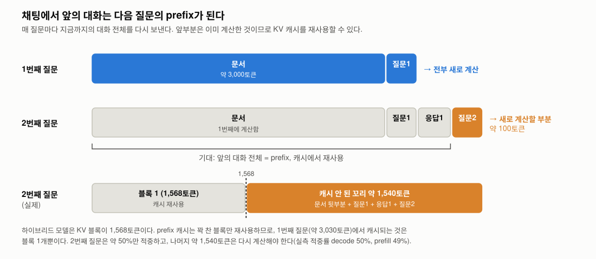
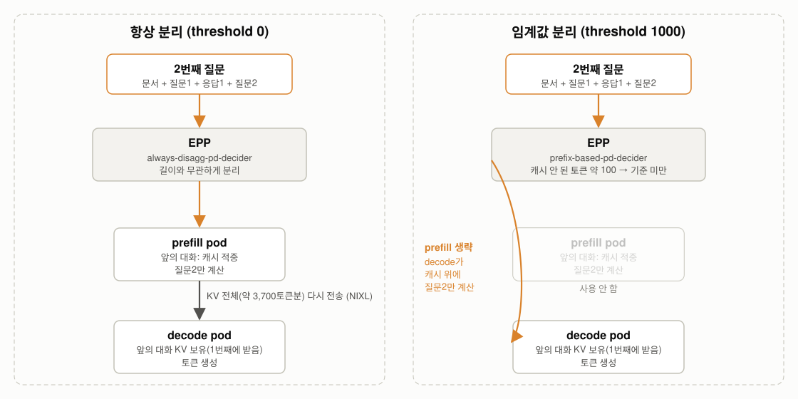
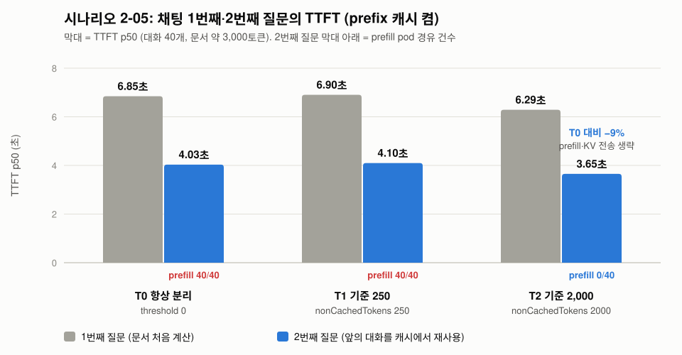

# 시나리오 2-05: prefix 캐시와 P/D

**모듈:** 분산 환경 활용 > 추론 단계 분리
**대상:** `llmd-pd/qwen38-int4-pd`
**상태:** 실측 완료(2026-11-12)

## 목적

채팅에서는 질문할 때마다 지금까지의 대화 전체를 다시 보낸다. 따라서 앞의 대화는 다음 질문의 prefix(앞부분)가 된다.
2번째 질문에서 새로 계산할 부분은 끝에 붙은 질문2(약 100토큰)뿐이고, 문서와 앞의 대화(약 3,700토큰)는 1번째 질문에서
이미 계산한 KV를 캐시에서 재사용할 수 있다.



P/D 구성에서 1번째 질문이 끝나면 앞의 대화 KV는 prefill pod(계산한 곳)와 decode pod(NIXL로 받은 곳)에 모두 남는다.
EPP가 2번째 질문을 어디로 보내느냐에 따라 처리 비용이 달라진다.

- **항상 분리(threshold 0):** 2번째 질문도 prefill pod로 간다. prefill pod는 캐시 덕분에 질문2만 계산하지만, 완성된 KV
  전체(약 3,700토큰분)를 decode pod로 다시 전송한다.
- **임계값 분리(threshold 1000):** EPP의 decider는 전체 길이가 아니라 캐시되지 않은 토큰 수를 센다. 약 100토큰으로 기준
  미만이므로 prefill pod를 건너뛰고, decode pod가 자기 캐시 위에 질문2만 계산한다. KV 전송이 없다.

다만 이 모델(하이브리드)은 KV 블록이 1,568토큰이어서, 캐시는 블록 단위로만 재사용된다. 첫 그림의 세 번째 줄처럼
2번째 질문에서 실제로 재사용되는 것은 블록 1개이고, 캐시 안 된 꼬리는 약 1,540토큰이다. 이 때문에 decider의 기준값에 따라
결과가 갈린다(아래 그림, T0·T1은 실측, T2는 원인 확인 실험).



본 시나리오는 임계값 분리에서 2번째 질문이 prefill pod를 건너뛰는지, 그 결과 TTFT가 얼마나 줄어드는지 확인한다.
2-04가 "프롬프트가 짧아서" prefill을 건너뛰는 경우라면, 2-05는 "프롬프트는 길지만 대부분 캐시되어 있어서" 건너뛰는 경우이다.

## 설정

Qwen3.8(하이브리드 모델)은 vLLM에서 prefix 캐시가 기본으로 꺼져 있다(2-08-2). decode와 prefill 모두
`--enable-prefix-caching`을 켠다. decode가 1번째 질문에서 받은 KV를 캐시로 보관해야 2번째 질문에서 재사용할 수 있다.

```sh
oc get llminferenceservice qwen38-int4-pd -n llmd-pd \
  -o jsonpath='{.spec.template.containers[0].env[?(@.name=="VLLM_ADDITIONAL_ARGS")].value}'          # decode
oc get llminferenceservice qwen38-int4-pd -n llmd-pd \
  -o jsonpath='{.spec.prefill.template.containers[0].env[?(@.name=="VLLM_ADDITIONAL_ARGS")].value}'  # prefill
```

## 실험 설계

| 항목 | 값 |
|---|---|
| 조건 | T0: `threshold: 0`(항상 분리), T1: `threshold: 1000`(`nonCachedTokens: 250`), T2: `threshold: 8000`(`nonCachedTokens: 2000`, 원인 확인용). 모두 prefix 캐시 켬 |
| 부하 | 대화 40개 × 질문 2개, 문서 약 3,000토큰, 동시 4, 응답 64토큰, 조건마다 새 문서 |
| 측정 | 모든 대화의 1번째 질문을 보낸 뒤 40초 쉬고 2번째 질문을 보낸다. 그 사이에 카운터를 찍어 질문 차례별로 센다 |
| 기록 | prefill pod 경유 건수, decode·prefill의 prefix 캐시 적중률(`vllm:prefix_cache_hits_total / queries_total`), TTFT |

```sh
cd openshift-ai-llmd-demo/harness
HARNESS_PROFILE=sno ./harness.sh scenario2-05-pd-prefix-cache   # 종료 시 EPP 설정과 vLLM 인자 원복
```

### 판정 기준

- T1에서 2번째 질문의 90% 이상이 prefill pod를 거치지 않고, decode의 prefix 캐시 적중률이 높다.
- T1의 2번째 질문 TTFT가 T0의 2번째 질문보다 짧다(KV 재전송 생략).

## 결과 (2026-11-12)

| 조건 | 질문 | prefill 경유 | KV 전송(TP 2) | decode 캐시 적중 | prefill 캐시 적중 | TTFT p50 |
|---|---|---|---|---|---|---|
| T0 항상 분리 | 1번째 | 40 / 40 | 80 | 0% | 0% | 6.85초 |
| T0 | 2번째 | 40 / 40 | 80 | 50% | 49% | 4.03초 |
| T1 `nonCachedTokens: 250` | 1번째 | 40 / 40 | 80 | 0% | 0% | 6.90초 |
| T1 | 2번째 | **40 / 40** | 80 | 50% | 49% | 4.10초 |
| T2 `nonCachedTokens: 2000` | 1번째 | 40 / 40 | 80 | 0% | 0% | 6.29초 |
| T2 | 2번째 | **0 / 40** | **0** | 50% | 0% | **3.65초** |



- prefix 캐시를 켜면 2번째 질문의 TTFT가 약 41% 줄었다(6.9초 → 4.0초). prefill pod가 캐시 적중분을 계산하지 않기 때문이다.
- T1에서 2번째 질문은 기대와 달리 모두 prefill pod를 거쳤다. 2-04에서 짧은 요청은 같은 설정으로 prefill을 건너뛰었으므로
  decider는 동작한다.

### T1에서 prefill을 건너뛰지 않은 원인

2번째 질문의 짜투리(캐시 안 된 부분)가 기준보다 컸다. 기대한 짜투리는 질문2(약 100토큰)였으나, 이 모델은 캐시를 1,568토큰
블록 단위로만 보관하므로 1번째 질문(약 3,030토큰)에서 블록 1개만 남았다. 따라서 실제 짜투리는 약 1,540토큰이었고, 기준
250을 넘어 prefill로 보내졌다(캐시 적중률 50%와 일치).

| | 기대(일반 모델, 블록 16토큰) | 실제(하이브리드 모델, 블록 1,568토큰) |
|---|---|---|
| 짜투리 | 약 100토큰 | 약 1,540토큰 |
| 기준 250과 비교 | 100 < 250 → decode | 1,540 ≥ 250 → prefill |

```sh
oc exec -n llmd-pd <decode-pod> -c main -- curl -sk https://localhost:8001/metrics | grep '^vllm:cache_config_info'   # block_size="1568"
oc logs -n llmd-pd <decode-pod> -c main | grep 'attention block size'                                              # 1568 tokens
oc logs deploy/qwen38-int4-pd-kserve-router-scheduler -n llmd-pd | grep 'Prefix DataProducer initialized'            # autoTune: true
```

## 결론

**하이브리드 모델의 P/D에서 채팅의 prefix 재사용 효과를 다 얻으려면, prefix 캐시를 켜고 decider 기준을 KV 블록 크기 이상으로 둔다.**

1. prefix 캐시를 켜면 채팅의 2번째 질문 TTFT가 약 40% 줄어든다(6.9초 → 4.0초). 하이브리드 모델은 prefix 캐시가 기본으로
   꺼져 있으므로 `--enable-prefix-caching`을 명시해야 한다.
2. 하이브리드 모델은 KV 블록이 1,568토큰이어서 캐시가 블록 단위로만 재사용된다. 약 3,000토큰 대화의 2번째 질문은 50%만
   적중하고, 캐시 안 된 꼬리가 최대 블록 크기만큼 남는다.
3. 따라서 P/D decider 기준(`nonCachedTokens`)을 블록 크기보다 작게 두면(250) 2번째 질문이 항상 분리되어 prefix 재사용에 따른
   prefill 생략이 일어나지 않는다. 기준을 블록 크기보다 크게 두면(2,000) prefill을 생략하고 TTFT가 추가로 9% 줄어든다.
4. 하이브리드 모델의 P/D 권장 설정은 prefix 캐시 켜기와 `nonCachedTokens` ≥ 블록 크기(`vllm:cache_config_info`의
   `block_size`)이다. 일반 모델(블록 16토큰)은 이 제약이 없다.
