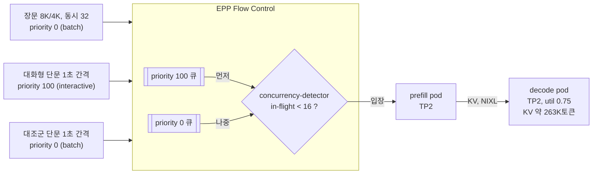

# 시나리오 2-06-6: EPP Flow Control로 KV 포화 회피

**모듈:** 분산 환경 활용 > 자원 계획
**대상:** `llmd-pd/qwen38-int4-pd`(prefill TP2 + decode TP2, L4 24GB), EPP `qwen38-int4-pd-kserve-router-scheduler`
**상태:** 실행 완료(2026-11-12). 2-08-8(429 대책 후보)에서 이 시나리오로 옮겼다

## 목적

2-06-1은 decode의 util을 올려 KV 용량을 늘리지만, vLLM 밖 여유가 줄어 OOM 위험이 커진다(0.95에서 약 1.1GiB). 본 시나리오는
반대 방향을 검증한다. decode util을 낮추어 OOM 여유를 확보하고, 줄어든 KV 용량은 EPP Flow Control이 vLLM에 보내는 요청
수를 제한하여 보완한다. 넘치는 요청은 vLLM 안에서 preemption되지 않고 EPP 큐에서 우선순위 순으로 대기한다(시나리오 21).

## 구성



입장 요청 수를 decode KV 용량 이하로 묶으면 decode KV가 100%에 도달하지 않으므로 preemption이 생기지 않는다. 대기는 vLLM이
아니라 EPP 큐에서 일어나므로 대화형 요청은 장문보다 먼저 입장한다.

## 적용 범위

Flow Control은 vLLM이 확보하는 메모리 양을 바꾸지 않는다. 따라서 운영 중 KV 포화만 다루며, 나머지 OOM 원인은 2-06-1~2-06-4가
다룬다.

| OOM·메모리 부족 원인 | Flow Control 효과 | 다루는 시나리오 |
|---|---|---|
| 기동 시 vLLM 예산 초과 | 없음 | 2-06-1, 2-06-2 |
| 활성화 피크(배치 토큰 크기) | 없음. 기동 시 프로파일링으로 상한이 정해진다 | 2-06-3 |
| vLLM 밖 메모리(NIXL·UCX, 단편화) | 없음. 여유는 util로만 확보한다 | 2-06-1 |
| 운영 중 decode KV 포화 → preemption·재계산 | **있음.** 입장 요청 수를 KV 용량 이하로 제한한다 | 본 시나리오 |

MaaS 토큰 한도 429에는 효과가 없다. 토큰 한도는 EPP 앞의 Gateway(Limitador)에서 판정되기 때문이다(2-08).

## KV 용량과 동시 요청 상한

장문 1건(입력 약 8K + 출력 4,096)은 KV 약 12.3K토큰을 쓴다(2-06-1의 추정치 기준).

출력이 짧으면 decode KV가 차지 않는다. prefill이 병목이므로(약 1,210토큰/초, 2-03) 장문이 decode에 도착하는 속도가 느리기 때문이다. 출력 4,096토큰이면 decode 체류가 약 200초가 되어, decode에 동시에 약 30건이 쌓인다.

| decode util | KV 토큰 | 장문 동시 수용량 | vLLM 밖 여유 |
|---|---|---|---|
| 0.85(기준) | 373K | 약 30 | 3.37GiB |
| 0.75 | 약 263K | 약 21 | 5.62GiB |

`maxConcurrency`는 수용량의 약 75%인 16으로 둔다. 장문 동시 32는 두 util 모두에서 수용량을 넘는다.

## 조건

| 단계 | decode util | EPP 설정 | 의도 |
|---|---|---|---|
| F0 | 0.85 | 현재 설정 | 기준. KV 포화와 preemption 정도 |
| F1 | 0.75 | 현재 설정 | OOM 여유 확보. KV 축소로 preemption 증가 예상 |
| F2 | 0.75 | Flow Control + `concurrency-detector`(16) | KV 포화 차단, 대화형 TTFT 유지 |

조건마다 아래 부하를 동시에 보낸다. 대조군은 대화형과 요청이 같고 우선순위만 다르다.

| 트래픽 | 요청 | 헤더 `x-llm-d-inference-objective` |
|---|---|---|
| 장문 | 입력 약 8K, 출력 4,096(`ignore_eos`), 동시 32, 600초 | `batch` |
| 대화형 단문 | 입력 약 100, 출력 64, 1초 간격, 장문 시작 180초 후부터 360초 | `interactive` |
| 대조군 단문 | 대화형과 같음 | `batch` |

요청은 클러스터 내 Job에서 `hostAliases`로 Gateway에 직접 보낸다. MaaS 외부 경로는 ELB 60초 끊김(2-08 H3)과 섞이기 때문이다.

## 절차

1) 사전 상태를 확인한다. InferencePool 이름은 3단계에서 쓴다.

```sh
oc get llminferenceservice qwen38-int4-pd -n llmd-pd
oc get inferencepool -n llmd-pd
oc get crd inferenceobjectives.llm-d.ai
oc get llminferenceservice qwen38-int4-pd -n llmd-pd -o jsonpath='{.spec.router.scheduler.config.inline}'
```

2) **F0.** 현재 설정(decode util 0.85)으로 부하를 보내고 측정 항목을 기록한다.

3) 우선순위를 정의한다. 헤더가 없는 요청과 `batch`는 priority 0으로 처리된다.

```sh
oc apply -n llmd-pd -f - <<'YAML'
apiVersion: llm-d.ai/v1alpha2
kind: InferenceObjective
metadata:
  name: interactive
spec:
  priority: 100
  poolRef:
    name: qwen38-int4-pd-inference-pool     # 1단계에서 확인한 이름
---
apiVersion: llm-d.ai/v1alpha2
kind: InferenceObjective
metadata:
  name: batch
spec:
  priority: 0
  poolRef:
    name: qwen38-int4-pd-inference-pool
YAML
```

4) **F1.** decode util을 0.75로 낮춘다. prefill은 그대로 둔다. decode가 재기동된다(약 8분).

```sh
oc edit llminferenceservice qwen38-int4-pd -n llmd-pd
# spec.template.containers[0].env VLLM_ADDITIONAL_ARGS: --gpu-memory-utilization=0.85 → 0.75
oc get llminferenceservice qwen38-int4-pd -n llmd-pd -o jsonpath='{.metadata.generation} {.status.observedGeneration}'
oc logs -n llmd-pd -l llm-d.ai/role=decode -c main | grep -E 'Available KV cache memory|GPU KV cache size|out of memory'
```

KV 토큰이 약 263K인지 확인한 뒤 2단계와 같은 부하를 보낸다.

5) **F2.** EPP 설정에 Flow Control을 추가한다. 기존 P/D 플러그인과 `schedulingProfiles`는 그대로 두고 아래 항목만 더한다.
EPP만 재기동되며 vLLM은 재기동되지 않는다(1~2분).

```yaml
spec:
  router:
    scheduler:
      config:
        inline:
          apiVersion: llm-d.ai/v1alpha1
          kind: EndpointPickerConfig
          featureGates:
            - flowControl
          plugins:
            # (기존 prefill-header-handler, prefill-filter, decode-filter, ..., pd-profile-handler 유지)
            - type: concurrency-detector
              parameters:
                maxConcurrency: 16          # decode KV 수용량(약 21)의 75%
            - type: fcfs-ordering-policy
            - type: global-strict-fairness-policy
          flowControl:
            defaultRequestTTL: 900s         # 장문 대기 시간보다 길게
            saturationDetector:
              pluginRef: concurrency-detector
```

```sh
oc edit llminferenceservice qwen38-int4-pd -n llmd-pd
oc rollout status deploy/qwen38-int4-pd-kserve-router-scheduler -n llmd-pd
oc logs -n llmd-pd deploy/qwen38-int4-pd-kserve-router-scheduler | grep -i 'flow control'
```

로그에서 Flow Control 활성화를 확인한 뒤 2단계와 같은 부하를 보낸다.

6) 원래 설정으로 되돌린다.

```sh
oc apply -f manifests/pd/qwen38-int4-pd.yaml
oc delete inferenceobjective interactive batch -n llmd-pd
```

## 측정

조건마다 같은 시간 범위로 Grafana `llmd-pd-latency`와 `llm-d Observability` > `Flow Control / Priority`를 캡처한다.

| 항목 | 출처 |
|---|---|
| decode KV 사용률 | `max by (pod) (vllm:kv_cache_usage_perc{namespace="llmd-pd", pod=~"qwen38-int4-pd-kserve-.*", pod!~".*prefill.*"})`(대시보드 ④ Decode KV cache usage) |
| preemption | `increase(vllm:num_preemptions_total{namespace="llmd-pd"}[5m])`(대시보드 ④ Preemption rate) |
| GPU 메모리 | `DCGM_FI_DEV_FB_USED{exported_namespace="llmd-pd"}` |
| 재기동 | `oc get pods -n llmd-pd -l 'llm-d.ai/role in (prefill,decode)'`의 RESTARTS |
| EPP 큐 대기·거절 | EPP 로그, `Flow Control / Priority` 패널 |
| 단문 TTFT p50·p95(대화형, 대조군), 장문 완료 시간·처리량 | 부하 Job 결과 |
| 역할별 running·waiting | 15초마다 prefill·decode pod의 `/metrics`. F2에서 어느 역할이 16건으로 묶이는지 확인한다 |

## 사전 확인 사항

- **포화 판정 대상:** P/D에서 `concurrency-detector`가 prefill과 decode 중 어느 endpoint의 요청 수를 세는지 확인한다. decode를
  세지 않으면 본 방안은 decode KV를 보호하지 못한다. 이 경우 `maxConcurrency`를 prefill 기준으로 다시 산정하거나 본
  시나리오를 중단한다.
- **기본 동작:** RHOAI 3.5.2 EPP는 Flow Control이 기본으로 켜져 있으나, 2-08 `saturate`(동시 48)에서 EPP 큐잉이 없었다. 기본
  `utilization-detector`는 요청을 vLLM 대기열로 넘기므로 우선순위가 적용되지 않는다(시나리오 21).
- **TTL:** 큐 대기가 `defaultRequestTTL`을 넘으면 요청이 거절된다. F2의 장문 대기 시간을 보고 조정한다.

## 판정 기준

| 항목 | 통과 조건 |
|---|---|
| OOM·재기동 | F1, F2 모두 없음 |
| decode KV 사용률 | F2에서 100% 미만 |
| preemption | F2가 F1보다 적고 0에 가까움 |
| 대화형 TTFT | F2의 대화형 < F2의 대조군, F2의 대화형 < F0 |
| 장문 완료 시간 | F2가 F0 대비 10% 이내 |

모두 통과하면 "decode util 0.75 + Flow Control"을 decode util 상향(2-06-1 R1·R2)의 대안으로 권장한다.

## 결과

실행일 2026-11-12. 세 조건 모두 OOM·재기동이 없었다. GPU 사용 최대는 18,930MiB이다. 요청 거절(TTL 초과)은 없었다.

| 항목 | F0(0.85) | F1(0.75) | F2(0.75 + Flow Control) |
|---|---|---|---|
| decode KV 토큰 | 373,321 | 265,654 | 265,654 |
| decode KV 사용률 최대 | 99.1% | 100% | **74.8%** |
| decode preemption | 83 | 71 | **0** |
| decode running / waiting 최대 | 33 / 23 | 23 / 28 | **16 / 1** |
| prefill waiting 최대 | 29 | 29 | 13 |
| 장문 완료 수, 출력 tok/s | 33건, 125.3 | 38건, 137.0 | **59건, 220.2** |
| 장문 e2e p50 | 962초 | 782초 | **533초** |
| 장문 TTFT p50 | 103초 | 128초 | 280초 |
| 대화형 완료 수, TTFT p50 / p95 | 5건, 0.92 / 187초 | 1건, 486초 | **14건, 8.8 / 150초** |
| 대조군 완료 수, TTFT p50 / p95 | 4건, 5.4 / 324초 | 1건, 463초 | 2건, 296초 |
| EPP 큐 대기 평균 | - | - | priority 100: 15.7초, 0: 282초 |

단문 probe는 동시 1로 순차 전송한다. 따라서 완료 수가 적을수록 대기가 길었다는 뜻이다.

사전 확인 결과:

- **포화 판정 대상:** F2에서 decode running이 정확히 16에서 멈췄다. prefill running은 최대 2이다. 따라서 `concurrency-detector`는 decode까지 포함한 요청 수를 센다.
- **기본 동작:** F0·F1에서는 EPP 큐 대기 지표가 없었다. 기본 설정은 요청을 vLLM 대기열로 넘긴다.

## 판정

| 항목 | 결과 | 판정 |
|---|---|---|
| OOM·재기동 | F1, F2 모두 없음 | 통과 |
| decode KV 사용률 | F2 74.8% | 통과 |
| preemption | F2 0, F1 71 | 통과 |
| 대화형 TTFT | F2 대화형 8.8초 < 대조군 296초. F0 대비 p50은 높고(0.92초) p95는 낮다(187초) | 부분 통과 |
| 장문 완료 시간 | e2e p50 962초 → 533초, 처리량 +76% | 통과 |

## 결론

- decode util 0.75 + Flow Control(16)은 KV 포화를 막았다. preemption이 사라졌다.
- 장문 처리량은 오히려 76% 늘었다. preemption에 따른 재계산이 없어졌기 때문이다.
- 대기는 vLLM이 아니라 EPP 큐에서 일어났다. 대화형 요청은 평균 15.7초 대기 후 입장했다.
- F0의 대화형 p50(0.92초)은 5건뿐이다. 대부분의 대화형 요청이 F0에서 수백 초 막혔다.
- 장문이 KV를 채우는 부하에서는 "decode util 0.75 + Flow Control"을 권장한다. decode util 상향(2-06-1)보다 OOM 여유가 크고 지연도 낮다.
- `maxConcurrency`는 단문 요청도 함께 센다. 따라서 장문 비율이 높을수록 KV 수용량 기준으로 산정해야 한다.

## 하네스 실행 (보조)

`scenario2-06-6-flow-control.sh`가 F0~F2와 원복을 수행한다. 요청은 Gateway ClusterIP로 보낸다(`LOADGEN_VIA=gateway`).

```sh
cd openshift-ai-llmd-demo/harness && HARNESS_PROFILE=sno ./harness.sh scenario2-06-6-flow-control
```
