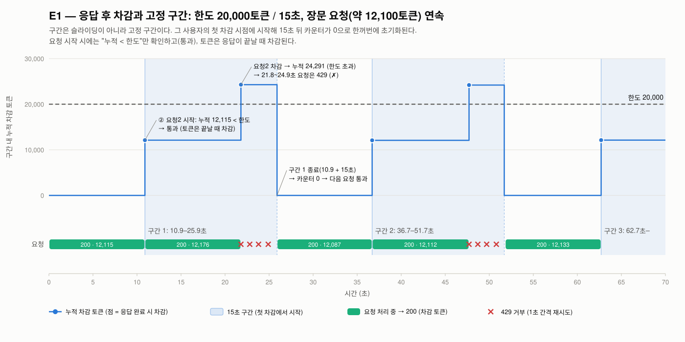

# 시나리오 2-07: 장문 호출과 MaaS 토큰 한도(429)

**모듈:** 분산 환경 활용 > 서비스 거버넌스
**대상:** `llmd-pd/qwen38-int4-pd`, MaaS 구독 `models-as-a-service/llmd-demo-sub`
**상태:** E1~E4 실측 완료(2026-11-05)

## 배경

고객은 사용자별 토큰 한도를 "토큰 / 15초"로 설계하고 있다. 구간이 짧으면 429가 잦고, 길면 429 후 재시도까지의 대기가
길어지므로 15초를 절충값으로 정했다. 장문(긴 프롬프트) 호출 뒤 429가 집중되는 현상이 쟁점이다.

## MaaS 토큰 한도의 구조

| 항목 | 내용 |
|---|---|
| 설정 | `MaaSSubscription.spec.modelRefs[].tokenRateLimits[]` (`limit`, `window`). window 단위는 `s`·`m`·`h` |
| 집행 | MaaS 컨트롤러가 모델 HTTPRoute마다 Kuadrant `TokenRateLimitPolicy`(`maas-trlp-<model>`)를 만들고 Limitador가 집계 |
| 카운터 | 구독 + 사용자 + 모델 단위(`auth.identity.selected_subscription_key`, `auth.identity.userid`). 같은 사용자의 동시 요청이 한 카운터를 공유 |
| 차감 | 요청 시작 시 카운터가 한도 미만이면 통과시키고, 응답의 `usage.total_tokens`(프롬프트 + 생성)를 응답 후에 더한다 |
| usage 보장 | Gateway의 ext_proc `payload-processing`(`stream-usage-enforcer` 플러그인)이 스트리밍 요청에 `stream_options.include_usage=true`를 강제로 넣는다 |
| 다단 한도 | `tokenRateLimits`가 목록이므로 짧은 구간과 긴 구간을 함께 둘 수 있다 |

```sh
oc get maassubscription <sub> -n models-as-a-service -o jsonpath='{.spec.modelRefs[*].tokenRateLimits}'
oc get tokenratelimitpolicy -A
oc get tokenratelimitpolicy maas-trlp-<model> -n <ns> -o jsonpath='{.spec.limits}'
```

## 실험 설계

한도를 일시적으로 바꾸고, 클러스터 안의 Job이 API 키(Secret)로 MaaS 경로에 요청을 보낸다. 요청마다 응답 코드, 사용 토큰,
rate-limit 관련 헤더를 기록하며, 종료 시 원래 한도로 되돌린다.

| 실험 | 한도 | 요청 | 확인 사항 |
|---|---|---|---|
| E1 | 20,000 / 15초 | 장문(약 12,000토큰, 응답 32토큰)을 60초 동안 연속, 429 후 1초 간격 재시도 | 차감 시점, 429 지속 시간(구간 방식), 응답 헤더 |
| E2 | 20,000 / 15초 | 장문 4건 동시, 이후 30초간 짧은 요청(약 40토큰)을 1초 간격 | 동시 통과에 의한 초과, 짧은 요청의 연쇄 429 |
| E3 | 20,000 / 15초 | E1과 같되 스트리밍 요청에 `include_usage`를 넣지 않음 | usage가 없을 때 차감 여부(한도 우회 가능성) |
| E4 | 20,000 / 15초 + 30,000 / 1분 | 장문 14건을 하나씩, 응답 후 5초 대기(시작 간격 약 16초) | 2단 한도의 집행, 긴 구간의 차단 시간 |

```sh
cd openshift-ai-llmd-demo/harness
HARNESS_PROFILE=sno ./harness.sh scenario2-07-maas-ratelimit                 # E1~E4, 약 10분
HARNESS_PROFILE=sno MAAS_RL_ARMS=E2 MAAS_RL_LIMIT=50000 ./harness.sh scenario2-07-maas-ratelimit
```

변경 후 정책 반영과 Authorino 구독 캐시(60초)를 고려하여 75초를 기다린 뒤 요청을 보낸다.

## 실측 결과 (2026-11-05)

### 예비 실행 (E1, 429 후 재시도 없이 연속 전송)

| 순서 | 시작 | 결과 | 사용 토큰 | 누적 |
|---|---|---|---|---|
| 1 | 0.0초 | 200 | 12,120 | 12,120 |
| 2 | 10.9초 | 200 | 12,151 | 24,271 |
| 3~12 | 21.9초~ | 429 | — | 24,271 |

- 2번 요청은 시작 시점의 누적(12,120)이 한도 미만이어서 통과하였고, 끝난 뒤 누적이 한도를 넘었다. 응답 후 차감 구조가 확인되었다.
- 429 응답에 `Retry-After`나 `x-ratelimit-*` 헤더가 없다. 클라이언트는 대기 시간을 알 수 없다.
- 장문 요청 1건은 약 11초(P/D, 12,000토큰)가 걸렸다.

### 본 실행

장문 요청은 약 12,100토큰(응답 32토큰)이며, P/D 구성에서 1건당 약 11초가 걸린다.

| 실험 | 한도 | 200 | 429 | 처리 토큰 | 차단 구간 |
|---|---|---|---|---|---|
| E1 연속 장문(60초) | 20,000 / 15초 | 5 | 8 | 60,623 | 21.8~25.9초(4.1초), 47.7~51.8초(4.1초) |
| E2 장문 4건 동시 + 단문 | 20,000 / 15초 | 13 | 7 | 49,327 | 36.8~44.0초(7.2초, 단문 차단) |
| E3 스트리밍 usage 미요청 | 20,000 / 15초 | 5 | 8 | 60,763 | 21.9~26.0초, 47.9~52.0초(각 4.1초) |
| E4 장문 5초 간격 | 20,000 / 15초 + 30,000 / 1분 | 6 | 8 | 72,869 | 47.7~72.9초(25.2초), 120.8초~(실행 종료까지 미복구) |

**E1 — 구간 방식.** 구간은 시계 정렬이 아니라 첫 차감 시점부터 15초이다. 1번 요청 차감(10.9초) + 15초 = 25.9초,
4번 요청 차감(36.7초) + 15초 = 51.7초에 각각 복구되었다. 따라서 429 후 최대 대기는 "구간 길이 − 첫 차감 이후 경과
시간"이다. 실효 처리량은 분당 60.6K 토큰으로 명목 한도(분당 80K)의 약 75%이다.

**E2 — 동시 초과와 연쇄 차단.** 장문 4건이 시작 시점의 잔량 확인을 모두 통과하여 한도의 2.4배(48,523토큰)를 사용하였다.
4건은 서버에서 순차 처리되어 11.4·20.1·28.9·36.8초에 차감되었고, 이후 같은 사용자의 단문(약 90토큰)이 7.2초간 429를
받았다(두 번째 구간 시작 28.9초 + 15초 = 43.9초에 복구).

**E3 — 스트리밍 usage.** MaaS는 응답의 usage로 차감하고, OpenAI 호환 스트리밍은 클라이언트가
`stream_options.include_usage`를 요청해야 usage를 보낸다. 따라서 클라이언트가 이 옵션을 빼면 차감을 피할 수 있다는
의심이 있어 이를 실험에 포함하였다. 결과는 E1과 같았다(차감 60,763토큰, 차단 4.1초 × 2). 한도 우회 경로는 없다.

usage를 넣는 주체는 Gateway의 `payload-processing` ext_proc이다. Kuadrant wasm 뒤에서 요청 본문을 수정하는
`stream-usage-enforcer` 플러그인이 `include_usage=true`를 강제한다. vLLM에는 강제 설정(`--enable-force-include-usage`)이 없다.

| 확인 | 결과 |
|---|---|
| vLLM 직접 호출(decode `:8001`), `include_usage` 없음 | usage 청크 0 |
| vLLM 직접 호출, `include_usage: true` | usage 청크 1 |
| `payload-processing` 로그 | `enforced stream_options.include_usage=true` 5건(E3의 200 응답 수와 일치), 그 외 `already set` |

```sh
oc get envoyfilter payload-processing -n openshift-ingress -o yaml        # ext_proc ipp 위치(wasm 뒤)
oc get cm payload-processing-plugins -n openshift-ingress -o yaml         # request 플러그인: stream-usage-enforcer
oc logs deploy/payload-processing -n openshift-ingress | grep stream-usage-enforcer
```

429로 거부된 요청은 wasm 단계에서 끝나므로 이 플러그인에 도달하지 않는다. 이 보장은 MaaS Gateway 경로에 한정되며,
모델 Service나 다른 Gateway로 직접 호출하면 usage도 차감도 없다.

**E4 — 2단 한도.** `tokenRateLimits`는 목록이며, 항목마다 독립된 카운터와 구간을 갖는다. E4는 다음 설정을 적용하였다.

```yaml
# MaaSSubscription spec.modelRefs[]
tokenRateLimits:
- limit: 20000      # 단기 한도: 15초 구간에 20,000토큰 (버스트 제어)
  window: 15s
- limit: 30000      # 장기 한도: 1분 구간에 30,000토큰 (총량 예산)
  window: 1m
```

두 카운터는 같은 요청의 usage로 동시에 차감되고, 요청 시작 시 **어느 하나라도** 한도에 도달해 있으면 429가 반환된다.
각 구간은 자신의 첫 차감 시점에 시작하여 따로 초기화된다.

요청 시작 간격(약 16초)이 15초보다 길어 15초 구간에는 요청이 1건(약 12,100 < 20,000)씩만 들어갔으므로, 15초 한도는
걸리지 않았다. 1분 구간(첫 차감 11.0초 → 71.0초)에는 3건(36,417토큰)이 들어가 30,000을 넘었고, 47.7~72.9초의 25.2초
동안 차단되었다. 단기 한도를 지키는 속도라도 장기 한도에 걸릴 수 있으며, 긴 구간에 걸리면 대기가 길어진다(15초 구간
4.1초 vs 1분 구간 25.2초). 두 한도가 함께 걸린 상태에서 15초 한도가 먼저 걸리는 경우는 E4에서 관측되지 않았다.

```sh
oc get maassubscription <sub> -n models-as-a-service -o jsonpath='{.spec.modelRefs[*].tokenRateLimits}'
oc get tokenratelimitpolicy maas-trlp-<model> -n <ns> -o jsonpath='{.spec.limits}'   # rates 목록으로 변환됨
```

## 결론

1. **429의 직접 원인은 "응답 후 차감 + 사용자 단위 고정 구간"이다.** 장문 요청 자체는 거부되지 않고 통과한 뒤, 같은
   구간의 후속 호출을 막는다. 동시 요청은 함께 통과하여 한도를 크게 넘긴다(E2: 2.4배).

   

   *그림 1. E1 실측의 시간축 재구성. 구간은 슬라이딩하지 않는다. 첫 차감 시점(10.9·36.7·62.7초)에 15초 구간이 시작되고,
   종료 시 누적이 0으로 초기화된다. 요청 2는 시작 시점 누적(12,115)이 한도 미만이어서 통과하고, 응답 후 차감으로 누적이
   한도를 넘어 구간 종료까지 429가 난다.*
2. **429 응답에 `Retry-After`가 없다.** 대기 시간은 클라이언트가 알 수 없으며, 최대 대기 = 구간 길이이다.
3. **구간 길이의 절충은 실측과 일치한다.** 15초 구간은 차단이 4~7초, 1분 구간은 25초 이상이었다.
4. **한도는 "단일 요청 최대 토큰 × 동시 요청 수" 이상이어야 한다.** 이보다 작으면 구간 설정과 무관하게 장문 후 429가 난다.

## 권고 (고객 15초 설계 기준)

| 항목 | 권고 |
|---|---|
| 15초 한도 | 단일 요청 최대 토큰(프롬프트 상한 + `max_tokens`) × 세션당 동시 실행 수 이상. 예: 100K 요청 × 동시 2 → 200K/15초 |
| 장기 예산 | 15초 한도와 별도로 시간당 한도를 둔다(`tokenRateLimits` 2개). 1분처럼 짧은 장기 구간은 차단을 길게 만든다 |
| 동시 실행 | 에이전트 세션당 동시 실행을 1~2로 제한하여 초과를 막는다 |
| 재시도 | `Retry-After`가 없으므로 지수 백오프(1초 시작, 지터, 상한 15초)로 재시도한다 |
| 분리 | 장문 에이전트와 대화형 요청을 다른 구독(또는 사용자)으로 분리하여 단문의 연쇄 차단을 막는다 |
