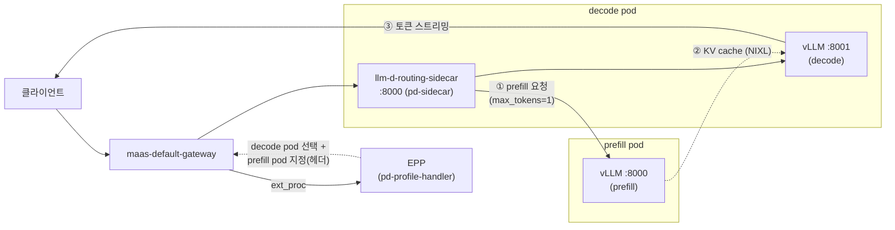

# 시나리오 2-01: Prefill/Decode 분리 (P/D Disaggregation)

**모듈:** 분산 환경 활용 > 추론 단계 분리
**대상 환경:** SNO(g6.8xlarge, NVIDIA L4 24GB × 1), OpenShift 4.20.42, RHOAI 3.5.2
**상태:** 설계. SNO에서는 기능 검증만 수행하고, 성능 비교는 GPU 2장 이상 환경에서 수행한다.

## 목적

LLM 추론은 프롬프트 전체를 한 번에 계산하는 prefill 단계(연산 집약)와 토큰을 하나씩 생성하는 decode 단계(메모리
대역폭 집약)로 이루어진다. 두 단계가 같은 vLLM pod에서 실행되면, 긴 prefill이 다른 요청의 decode를 지연시킨다.
P/D 분리는 두 단계를 서로 다른 pod에 배치하고, prefill pod가 계산한 KV cache를 NIXL로 decode pod에 전달한다.
본 시나리오는 RHOAI 3.5.2의 `LLMInferenceService.spec.prefill` 구성이 요청을 두 단계로 나누어 처리하는지 검증한다.

## 구조



1. EPP는 decode pod를 선택하고, prefix cache에 없는 프롬프트 토큰 수가 임계값을 넘으면 prefill pod도 지정한다.
2. decode pod의 routing sidecar는 prefill pod에 요청을 보내 KV cache를 계산하게 한다.
3. decode pod의 vLLM은 응답에 포함된 `kv_transfer_params`로 prefill pod의 KV cache를 NIXL로 가져와 decode를 수행한다.

## RHOAI 3.5.2 구성 요소 (클러스터 확인)

| 구성 요소 | 내용 | 확인 명령 |
|---|---|---|
| prefill 템플릿 | `v3-5-2-kserve-config-llm-prefill-template`. `spec.prefill`의 vLLM이 포트 8000으로 기동 | `oc get llminferenceserviceconfig -n redhat-ods-applications` |
| decode 템플릿 | `v3-5-2-kserve-config-llm-decode-template`. vLLM은 포트 8001, initContainer `llm-d-routing-sidecar`가 포트 8000에서 요청을 받음 | 위와 동일 |
| routing sidecar | `/app/pd-sidecar --port=8000 --vllm-port=8001 --kv-connector=nixlv2` | `oc get llminferenceserviceconfig v3-5-2-kserve-config-llm-decode-template -n redhat-ods-applications -o jsonpath='{.spec.template.initContainers[0].command}'` |
| KV 전달 설정 | 템플릿은 사용자가 `--kv-transfer-config`를 지정하지 않은 경우에만 자체 값을 넣는다. 본 시나리오는 두 pod에 NixlConnector를 명시한다 | `oc get deploy -n llmd-pd -o yaml \| grep -A1 kv-transfer-config` |
| API 필드 | `spec.prefill`(replicas, template, parallelism, kvCacheOffloading) | `oc explain llminferenceservice.spec.prefill` |

## 환경 제약 (SNO)

| 항목 | 현재 환경 | 영향 |
|---|---|---|
| GPU 수 | L4 1장 | P/D는 GPU를 요청하는 pod가 최소 2개(prefill 1, decode 1) 필요하다 |
| GPU 점유 | RHDP 기본 모델 `my-first-model/llama-32-3b-instruct`가 1장 사용 | 시험 전에 정지해야 한다 |
| GPU 공유 | GPU Operator의 time-slicing 미설정(`devicePlugin.config` 비어 있음) | time-slicing으로 GPU 1장을 논리 GPU 여러 장으로 노출한다 |
| GPU 메모리 | 24GB를 두 vLLM이 나누어 사용 | 각 pod의 `--gpu-memory-utilization`을 0.40 이하로 제한한다 |

time-slicing 환경에서 두 pod는 같은 물리 GPU를 번갈아 사용하므로, 측정한 지연과 처리량은 P/D 분리의 성능을 나타내지
않는다. SNO에서는 요청 경로와 KV 전달 여부만 검증하고, 성능 비교(측정 C)는 GPU 2장 이상의 환경에서 수행한다.

## 준비

### 1. GPU time-slicing 활성화

```sh
oc apply -f - <<'EOF'
apiVersion: v1
kind: ConfigMap
metadata:
  name: time-slicing-config
  namespace: nvidia-gpu-operator
data:
  any: |-
    version: v1
    sharing:
      timeSlicing:
        resources:
        - name: nvidia.com/gpu
          replicas: 4
EOF
oc patch clusterpolicy gpu-cluster-policy --type=merge \
  -p '{"spec":{"devicePlugin":{"config":{"name":"time-slicing-config","default":"any"}}}}'
oc get node -o jsonpath='{.items[0].status.allocatable.nvidia\.com/gpu}'     # 4 (device plugin 재기동 후)
```

### 2. 기존 모델 정지

```sh
oc annotate inferenceservice llama-32-3b-instruct -n my-first-model serving.kserve.io/stop=true --overwrite
oc get pods -n my-first-model                                                   # predictor pod 종료 확인
```

### 3. MaaS Gateway 확인

```sh
oc get gateway maas-default-gateway -n openshift-ingress
```

## 매니페스트

`llmd-pd/llmd-pd`: Qwen2.5-1.5B-Instruct, prefill 1개 + decode 1개. 임계값 0은 모든 요청을 P/D 경로로 보낸다.

```yaml
apiVersion: serving.kserve.io/v1alpha2
kind: LLMInferenceService
metadata:
  name: llmd-pd
  namespace: llmd-pd
spec:
  model:
    name: Qwen2.5-1.5B-Instruct
    uri: hf://Qwen/Qwen2.5-1.5B-Instruct
  replicas: 1                                   # decode
  template:
    containers:
    - name: main
      env:
      - name: VLLM_ADDITIONAL_ARGS
        value: >-
          --gpu-memory-utilization=0.40 --max-model-len=8192
          --kv-transfer-config={"kv_connector":"NixlConnector","kv_role":"kv_both"}
      resources:
        limits:   {cpu: "2", memory: 8Gi, nvidia.com/gpu: "1"}
        requests: {cpu: "2", memory: 8Gi, nvidia.com/gpu: "1"}
  prefill:
    replicas: 1
    template:
      containers:
      - name: main
        env:
        - name: VLLM_ADDITIONAL_ARGS
          value: >-
            --gpu-memory-utilization=0.40 --max-model-len=8192
            --kv-transfer-config={"kv_connector":"NixlConnector","kv_role":"kv_both"}
        resources:
          limits:   {cpu: "2", memory: 8Gi, nvidia.com/gpu: "1"}
          requests: {cpu: "2", memory: 8Gi, nvidia.com/gpu: "1"}
  router:
    gateway:
      refs:
      - name: maas-default-gateway
        namespace: openshift-ingress
    route: {}
    scheduler:
      config:
        inline:
          apiVersion: llm-d.ai/v1alpha1
          kind: EndpointPickerConfig
          plugins:
          - type: prefill-header-handler
          - type: prefill-filter
          - type: decode-filter
          - type: prefix-cache-scorer
          - type: queue-scorer
          - type: max-score-picker
          - type: pd-profile-handler
            parameters:
              threshold: 0
          schedulingProfiles:
          - name: prefill
            plugins:
            - pluginRef: prefill-filter
            - pluginRef: queue-scorer
            - pluginRef: max-score-picker
          - name: decode
            plugins:
            - pluginRef: decode-filter
            - pluginRef: prefix-cache-scorer
            - pluginRef: queue-scorer
            - pluginRef: max-score-picker
```

플러그인 이름과 `pd-profile-handler` 파라미터는 EPP 이미지 버전(템플릿 기준 0.10.0)에 따라 다를 수 있다. 배포 직후
EPP 로그에서 플러그인 로딩 오류를 확인한다.

```sh
oc create namespace llmd-pd
oc apply -f llmd-pd.yaml
oc get llminferenceservice llmd-pd -n llmd-pd
oc get pods -n llmd-pd -L llm-d.ai/role                                         # prefill / decode 역할 라벨
oc logs deploy/llmd-pd-kserve-router-scheduler -n llmd-pd | grep -i -E 'plugin|error' | head
```

## 측정 설계

| 측정 | 환경 | 조건 | 확인 사항 |
|---|---|---|---|
| A. 요청 경로 | SNO | 긴 프롬프트(약 2,000토큰) 1건 | prefill pod가 요청을 받고, decode pod가 생성 토큰을 반환함 |
| B. 임계값 | SNO | `threshold` 0 / 1000, 짧은 프롬프트(약 100토큰)와 긴 프롬프트 | 임계값 미만의 요청은 prefill pod를 거치지 않음 |
| C. 성능 | GPU 2장 이상 | 통합(replicas 2) vs P/D(1P + 1D), 긴 프롬프트와 짧은 프롬프트 혼합 부하 | TTFT, ITL(p50·p95), 초당 생성 토큰 수 |

### A·B 확인 방법

```sh
# 요청 전후 각 pod의 토큰 카운터 비교 (prefill pod: prompt 증가·generation 약 1, decode pod: generation 증가)
oc exec -n llmd-pd <pod> -c main -- curl -sk https://localhost:<port>/metrics \
  | grep -E '^vllm:(prompt_tokens_total|generation_tokens_total)'
oc logs -n llmd-pd <decode-pod> -c llm-d-routing-sidecar | grep -i prefill        # prefill 대상 지정 기록
oc logs -n llmd-pd <prefill-pod> -c main | grep -i -E 'nixl|kv transfer'          # KV 전달 기록
```

포트는 prefill pod가 8000, decode pod의 vLLM이 8001이다.

## 판정 기준

- **A 성공:** 요청 1건에 대해 prefill pod의 `prompt_tokens_total`이 프롬프트 길이만큼 증가하고, decode pod의
  `generation_tokens_total`이 생성 길이만큼 증가한다. 응답은 정상(HTTP 200, 본문 비어 있지 않음)이다.
- **B 성공:** `threshold: 1000`에서 짧은 프롬프트는 prefill pod 카운터를 증가시키지 않는다.
- **실패 시 확인:** NIXL 연결 오류(prefill·decode 로그), EPP 플러그인 로딩 오류, pod의 `llm-d.ai/role` 라벨 누락.

## 예상

- A·B는 time-slicing 환경에서도 성립한다. KV cache는 같은 물리 GPU 안에서 전달된다.
- C에서는 긴 프롬프트가 섞인 부하일수록 P/D가 decode의 ITL p95를 낮출 것으로 예상한다. 대신 KV 전달 비용 때문에
  짧은 프롬프트만 있는 부하의 TTFT는 통합 구성보다 길어질 수 있다.

## 원복

```sh
oc delete llminferenceservice llmd-pd -n llmd-pd --wait=true && oc delete namespace llmd-pd
oc annotate inferenceservice llama-32-3b-instruct -n my-first-model serving.kserve.io/stop-
oc patch clusterpolicy gpu-cluster-policy --type=merge -p '{"spec":{"devicePlugin":{"config":{"name":"","default":""}}}}'
oc delete configmap time-slicing-config -n nvidia-gpu-operator
```
